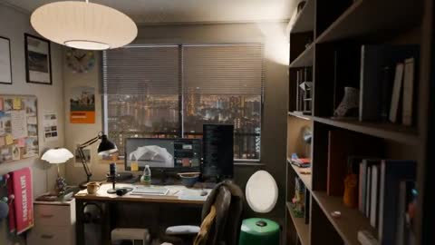

[← Back to gallery](../browse/interactive.en.md) · [简体中文](2109993123606941955.md)

# A Personal Study with Moving Details

**[KOBATAKA｜Vibe Modeling · @shion\_takk](https://x.com/shion_takk)** · 3D & interactive · 20s

> Discovery pool · Source verified; catalog details being completed.

**[▶ Open gallery to play](https://guanmo-ai.github.io/awesome-ai-motion/?lang=en#case-2109993123606941955)** · [Original post](https://x.com/shion_takk/status/2109993123606941955)

Click the cover to open the gallery and play.

The camera moves past a warmly lit desk, bookshelves and a city window, while screens and small animated details bring the digital study to life.

## What to learn

Ground a scene in personal references before choosing how each object is made.

**Try it yourself** · Editorial suggestions based on public source material, not a complete record of the creator’s process.

1. Collect the room mood, personal context and real objects first.
2. Choose procedural modeling or a Tripo mesh for each object and check transparent materials.
3. Arrange cameras, screens and small movements, refining materials and layout in passes.

Tools mentioned in the source：Opus 5.5 · Blender · Tripo

[Source 1](https://x.com/shion_takk/status/2109993123606941955)

No public prompt has been verified. [View the original post](https://x.com/shion_takk/status/2109993123606941955)

Bookmarks — · Likes 386 · Views —

## Source record

- Original post: [@shion\_takk](https://x.com/shion_takk/status/2109993123606941955) · 2026-10-13T13:02:17+00:00
- Model attribution: Claude Opus 5.5 · [Creator’s statement](https://x.com/shion_takk/status/2109993123606941955)
- Prompt lookup: [Creator post](https://x.com/shion_takk/status/2109993123606941955) · 2026-10-26 15:21 UTC
- Cover source: [Original cover source](https://x.com/shion_takk/status/2109993123606941955) · 4s
- Metrics snapshot: [Original X post](https://x.com/shion_takk/status/2109993123606941955) · 2026-10-26 14:56 UTC
- Gallery video source: [Original post media record](https://x.com/shion_takk/status/2109993123606941955) · 2026-10-26 15:21 UTC · Post/media correspondence and media response checked; external reference, no re-upload

Model attribution is based on creator statements. Prompts have not been independently rerun; sound and visuals have not received a uniform quality rating. Videos reference original post media, not our uploads; redistribution permission has not been verified.
