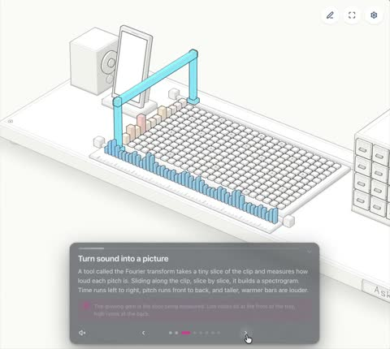

[← Back to gallery](../browse/education.en.md) · [简体中文](2110127563238785480.md)

# A 3D Explainer of Shazam Sound Fingerprints

**[Numa ᯅ · @numaausaumon](https://x.com/numaausaumon)** · Education & explainers · 40s

> Discovery pool · Source verified; catalog details being completed.

**[▶ Open gallery to play](https://guanmo-ai.github.io/awesome-ai-motion/?lang=en#case-2110127563238785480)** · [Original post](https://x.com/numaausaumon/status/2110127563238785480)

Click the cover to open the gallery and play.

[Interactive Shazam algorithm demo](https://ask.jig.com/j/ZTJoPvMuKxWy)

Sound fingerprints, retrieval paths and 3D elements move together in an algorithm-themed demonstration.

## Source & web pages

- **Public web page**：[Interactive Shazam algorithm demo](https://ask.jig.com/j/ZTJoPvMuKxWy)
  [Link source](https://x.com/numaausaumon/status/2110127563238785480) · Link checked 2026-11-02 15:38 UTC

The creator has shared instructions; this catalog links to the source without redistributing the full text or translation. [Read the creator’s original](https://x.com/numaausaumon/status/2110127563238785480)

Bookmarks — · Likes — · Views —

## Source record

- Original post: [@numaausaumon](https://x.com/numaausaumon/status/2110127563238785480) · 2026-10-13T21:56:30+00:00
- Model attribution: Claude Opus 5.5 · [Creator’s statement](https://x.com/numaausaumon/status/2110127563238785480)
- Prompt source: [Creator post](https://x.com/numaausaumon/status/2110127563238785480) · 2026-11-02 15:38 UTC
- Cover source: [Original cover source](https://x.com/numaausaumon/status/2110127563238785480) · 7.92s
- Metrics snapshot: [Original X post](https://x.com/numaausaumon/status/2110127563238785480) · 2026-11-02 15:08 UTC
- Gallery video source: [Original post media record](https://x.com/numaausaumon/status/2110127563238785480) · 2026-11-02 15:38 UTC · Post/media correspondence and media response checked; external reference, no re-upload

Model attribution is based on creator statements. Prompts have not been independently rerun; sound and visuals have not received a uniform quality rating. Videos reference original post media, not our uploads; redistribution permission has not been verified.
