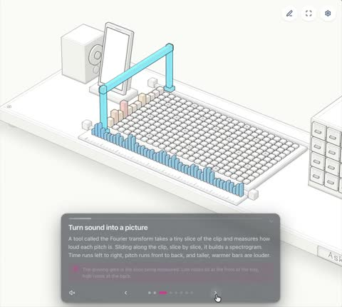

[← 返回图库](../browse/education.md) · [English](2110127563238785480.en.md)

# Shazam 声音指纹的三维图解

**[Numa ᯅ · @numaausaumon](https://x.com/numaausaumon)** · 知识讲解 · 40s

> 发现池 · 来源已核对，编目资料待完善。

**[▶ 打开画廊播放](https://guanmo-ai.github.io/awesome-ai-motion/#case-2110127563238785480)** · [作者原帖](https://x.com/numaausaumon/status/2110127563238785480)

点击封面打开画廊播放。

[Shazam 算法交互演示](https://ask.jig.com/j/ZTJoPvMuKxWy)

声音指纹、检索路径与立体构件联动，解释作者的算法主题演示。

## 源码与网页

- **公开网页**：[Shazam 算法交互演示](https://ask.jig.com/j/ZTJoPvMuKxWy)
  [链接出处](https://x.com/numaausaumon/status/2110127563238785480) · 链接核对 2026-11-02 15:38 UTC

作者已公开指令；本站仅提供原帖入口，不再分发全文或译文。 [查看作者原文](https://x.com/numaausaumon/status/2110127563238785480)

收藏 — · 点赞 — · 浏览 —

## 来源记录

- 作品原帖: [@numaausaumon](https://x.com/numaausaumon/status/2110127563238785480) · 2026-10-13T21:56:30+00:00
- 模型归因: Claude Opus 5.5 · [作者说明](https://x.com/numaausaumon/status/2110127563238785480)
- 提示词出处: [作者原帖](https://x.com/numaausaumon/status/2110127563238785480) · 2026-11-02 15:38 UTC
- 封面来源: [原帖封面来源](https://x.com/numaausaumon/status/2110127563238785480) · 7.92s
- 互动快照: [X 原帖](https://x.com/numaausaumon/status/2110127563238785480) · 2026-11-02 15:08 UTC
- 画廊原视频: [原帖媒体记录](https://x.com/numaausaumon/status/2110127563238785480) · 2026-11-02 15:38 UTC · 已核对原帖媒体对应与媒体响应；外部引用，不重新上传

模型依据来自作者自述，未独立重跑提示词，也未对音画作统一质量评级。视频引用作者原帖媒体，未由本站重新上传，转载许可未确认。
