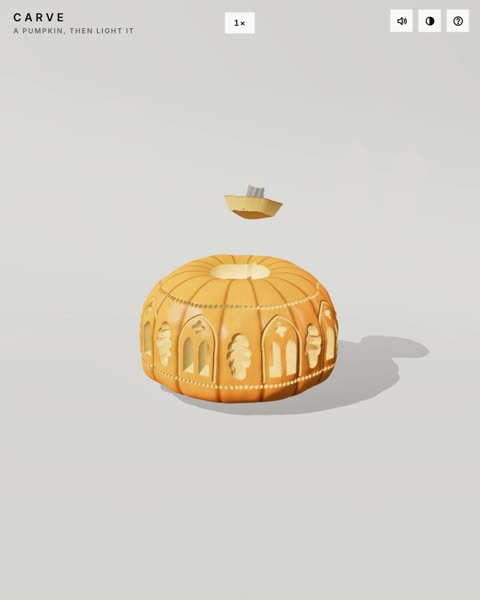

[← Back to gallery](../browse/interactive.en.md) · [简体中文](2110158162838143136.md)

# Pumpkin House Opening and Assembly

**[wowbuffet · @wowbuffet](https://x.com/wowbuffet)** · 3D & interactive · 41s

> Discovery pool · Source verified; catalog details being completed.

**[▶ Open gallery to play](https://guanmo-ai.github.io/awesome-ai-motion/?lang=en#case-2110158162838143136)** · [Original post](https://x.com/wowbuffet/status/2110158162838143136)

Click the cover to open the gallery and play.

A pumpkin house moves between assembled and separated states to reveal its interior.

No public prompt has been verified. [View the original post](https://x.com/wowbuffet/status/2110158162838143136)

Bookmarks — · Likes — · Views —

## Source record

- Original post: [@wowbuffet](https://x.com/wowbuffet/status/2110158162838143136) · 2026-10-13T23:58:05+00:00
- Model attribution: Claude Opus 5.5 · [Creator’s statement](https://x.com/wowbuffet/status/2110158162838143136)
- Prompt lookup: [Creator post](https://x.com/wowbuffet/status/2110158162838143136) · 2026-11-03 09:18 UTC
- Cover source: [Original cover source](https://x.com/wowbuffet/status/2110158162838143136) · 28.69s
- Metrics snapshot: [Original X post](https://x.com/wowbuffet/status/2110158162838143136) · 2026-11-03 08:38 UTC
- Gallery video source: [Original post media record](https://x.com/wowbuffet/status/2110158162838143136) · 2026-11-03 09:18 UTC · Post/media correspondence and media response checked; external reference, no re-upload

Model attribution is based on creator statements. Prompts have not been independently rerun; sound and visuals have not received a uniform quality rating. Videos reference original post media, not our uploads; redistribution permission has not been verified.
