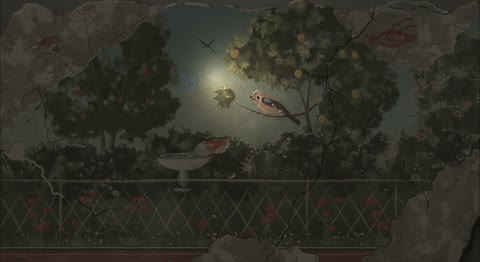

[← Back to gallery](../browse/interactive.en.md) · [简体中文](2110267367435730980.md)

# Island Light and Texture in JavaScript

**[Pradeep Kapoor · @pradeepXkapoor](https://x.com/pradeepXkapoor)** · 3D & interactive · 21s

> Discovery pool · Source verified; catalog details being completed.

**[▶ Open gallery to play](https://guanmo-ai.github.io/awesome-ai-motion/?lang=en#case-2110267367435730980)** · [Original post](https://x.com/pradeepXkapoor/status/2110267367435730980)

Click the cover to open the gallery and play.

Code draws island terrain, trees and night lighting as a miniature landscape.

No public prompt has been verified. [View the original post](https://x.com/pradeepXkapoor/status/2110267367435730980)

Bookmarks — · Likes — · Views —

## Source record

- Original post: [@pradeepXkapoor](https://x.com/pradeepXkapoor/status/2110267367435730980) · 2026-10-14T07:12:01+00:00
- Model attribution: Claude Opus 5.5 · [Creator’s statement](https://x.com/pradeepXkapoor/status/2110267367435730980)
- Prompt lookup: [Creator post](https://x.com/pradeepXkapoor/status/2110267367435730980) · 2026-11-03 09:18 UTC
- Cover source: [Original cover source](https://x.com/pradeepXkapoor/status/2110267367435730980) · 4.21s
- Metrics snapshot: [Original X post](https://x.com/pradeepXkapoor/status/2110267367435730980) · 2026-11-03 08:38 UTC
- Gallery video source: [Original post media record](https://x.com/pradeepXkapoor/status/2110267367435730980) · 2026-11-03 09:18 UTC · Post/media correspondence and media response checked; external reference, no re-upload

Model attribution is based on creator statements. Prompts have not been independently rerun; sound and visuals have not received a uniform quality rating. Videos reference original post media, not our uploads; redistribution permission has not been verified.
