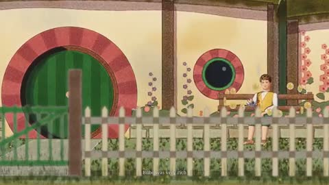

[← Back to gallery](../browse/stories.en.md) · [简体中文](2110433119731945964.md)

# A Cartoon Opening for The Lord of the Rings

**[DreW · @devteamdrew](https://x.com/devteamdrew)** · Narrative films · 93s

> Discovery pool · Source verified; catalog details being completed.

**[▶ Open gallery to play](https://guanmo-ai.github.io/awesome-ai-motion/?lang=en#case-2110433119731945964)** · [Original post](https://x.com/devteamdrew/status/2110433119731945964)

Click the cover to open the gallery and play.

Stylized characters and miniature landscapes retell an opening sequence.

No public prompt has been verified. [View the original post](https://x.com/devteamdrew/status/2110433119731945964)

Bookmarks 143 · Likes 148 · Views 7,326

## Source record

- Original post: [@devteamdrew](https://x.com/devteamdrew/status/2110433119731945964) · 2026-10-14T18:10:40+00:00
- Model attribution: Opus 5.5 · [Creator’s statement](https://x.com/devteamdrew/status/2110433119731945964)
- Prompt lookup: [Creator post](https://x.com/devteamdrew/status/2110433119731945964) · 2026-10-16 06:37 UTC
- Cover source: [Original cover source](https://x.com/devteamdrew/status/2110433119731945964) · 18.6s
- Metrics snapshot: [Original X post](https://x.com/devteamdrew/status/2110433119731945964) · 2026-10-16 06:37 UTC
- Gallery video source: [Original post media record](https://x.com/devteamdrew/status/2110433119731945964) · 2026-10-16 06:37 UTC · Post/media correspondence and media response checked; external reference, no re-upload

Model attribution is based on creator statements. Prompts have not been independently rerun; sound and visuals have not received a uniform quality rating. Videos reference original post media, not our uploads; redistribution permission has not been verified.
