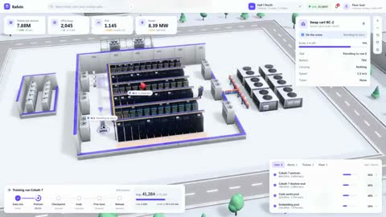

[← Back to gallery](../browse/interactive.en.md) · [简体中文](2110475736213819575.md)

# Cooling and Transport in an AI Data Center

**[An Xuan · @anxuanng](https://x.com/anxuanng)** · 3D & interactive · 30s

> Discovery pool · Source verified; catalog details being completed.

**[▶ Open gallery to play](https://guanmo-ai.github.io/awesome-ai-motion/?lang=en#case-2110475736213819575)** · [Original post](https://x.com/anxuanng/status/2110475736213819575)

Click the cover to open the gallery and play.

Racks, cooling equipment and robots run together in a 3D data center, with routes and metrics showing operation. The creator names Opus 5.5, Blender and Three.js.

No public prompt has been verified. [View the original post](https://x.com/anxuanng/status/2110475736213819575)

Bookmarks 161 · Likes 241 · Views 9,344

## Source record

- Original post: [@anxuanng](https://x.com/anxuanng/status/2110475736213819575) · 2026-10-14T21:00:00+00:00
- Model attribution: Claude Opus 5.5 · [Creator’s statement](https://x.com/anxuanng/status/2110475736213819575)
- Prompt lookup: [Creator post](https://x.com/anxuanng/status/2110475736213819575) · 2026-10-20 17:09 UTC
- Cover source: [Original cover source](https://x.com/anxuanng/status/2110475736213819575) · 6s
- Metrics snapshot: [Original X post](https://x.com/anxuanng/status/2110475736213819575) · 2026-10-20 17:09 UTC
- Gallery video source: [Original post media record](https://x.com/anxuanng/status/2110475736213819575) · 2026-10-20 17:09 UTC · Post/media correspondence and media response checked; external reference, no re-upload

Model attribution is based on creator statements. Prompts have not been independently rerun; sound and visuals have not received a uniform quality rating. Videos reference original post media, not our uploads; redistribution permission has not been verified.
