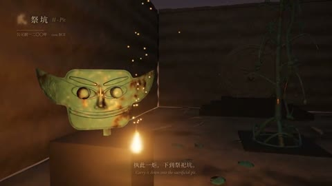

[← Back to gallery](../browse/education.en.md) · [简体中文](2110543188520017945.md)

# Sanxingdui Bronze and Particles in Six Acts

**[yi · @YionxpYi](https://x.com/YionxpYi)** · Education & explainers · 99s

> Discovery pool · Source verified; catalog details being completed.

**[▶ Open gallery to play](https://guanmo-ai.github.io/awesome-ai-motion/?lang=en#case-2110543188520017945)** · [Original post](https://x.com/YionxpYi/status/2110543188520017945)

Click the cover to open the gallery and play.

Bronze objects, statues and particle transitions form a six-act Sanxingdui-themed animation.

No public prompt has been verified. [View the original post](https://x.com/YionxpYi/status/2110543188520017945)

Bookmarks — · Likes — · Views —

## Source record

- Original post: [@YionxpYi](https://x.com/YionxpYi/status/2110543188520017945) · 2026-10-15T01:28:02+00:00
- Model attribution: Claude Opus 5.5 · [Creator’s statement](https://x.com/YionxpYi/status/2110543188520017945)
- Prompt lookup: [Creator post](https://x.com/YionxpYi/status/2110543188520017945) · 2026-11-02 09:52 UTC
- Cover source: [Original cover source](https://x.com/YionxpYi/status/2110543188520017945) · 19.81s
- Metrics snapshot: [Original X post](https://x.com/YionxpYi/status/2110543188520017945) · 2026-11-02 09:19 UTC
- Gallery video source: [Original post media record](https://x.com/YionxpYi/status/2110543188520017945) · 2026-11-02 09:52 UTC · Post/media correspondence and media response checked; external reference, no re-upload

Model attribution is based on creator statements. Prompts have not been independently rerun; sound and visuals have not received a uniform quality rating. Videos reference original post media, not our uploads; redistribution permission has not been verified.
