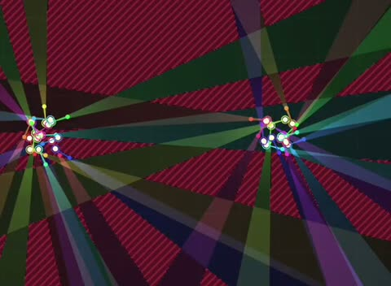

[← 返回图库](../browse/education.md) · [English](2110658162214785351.en.md)

# 灯塔扇形照明的动态几何演示

**[Captain Pleasure, Andrés Gómez Emilsson · @algekalipso](https://x.com/algekalipso)** · 知识讲解 · 26s

> 发现池 · 来源已核对，编目资料待完善。

**[▶ 打开画廊播放](https://guanmo-ai.github.io/awesome-ai-motion/#case-2110658162214785351)** · [作者原帖](https://x.com/algekalipso/status/2110658162214785351)

点击封面打开画廊播放。

多个点光源的扇形光束随位置和方向改变，呈现作者讨论的平面覆盖问题；动画由 Opus 5.5 辅助制作。

未取得作者公开提示词。 [查看作者原帖](https://x.com/algekalipso/status/2110658162214785351)

收藏 143 · 点赞 381 · 浏览 28,416

## 来源记录

- 作品原帖: [@algekalipso](https://x.com/algekalipso/status/2110658162214785351) · 2026-10-15T09:04:54+00:00
- 模型归因: Claude Opus 5.5 · [作者说明](https://x.com/algekalipso/status/2110658162214785351)
- 提示词查阅记录: [作者原帖](https://x.com/algekalipso/status/2110658162214785351) · 2026-10-20 15:51 UTC
- 封面来源: [原帖封面来源](https://x.com/algekalipso/status/2110658162214785351) · 5.13s
- 互动快照: [X 原帖](https://x.com/algekalipso/status/2110658162214785351) · 2026-10-20 15:51 UTC
- 画廊原视频: [原帖媒体记录](https://x.com/algekalipso/status/2110658162214785351) · 2026-10-20 15:51 UTC · 已核对原帖媒体对应与媒体响应；外部引用，不重新上传

模型依据来自作者自述，未独立重跑提示词，也未对音画作统一质量评级。视频引用作者原帖媒体，未由本站重新上传，转载许可未确认。
