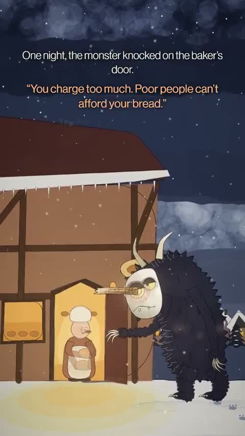

[← 返回图库](../browse/stories.md) · [English](2110691314765639839.en.md)

# The Beam：暗色民俗卡通短片

**[Govind Singh · @Govindaiii](https://x.com/Govindaiii)** · 叙事短片 · 112s

> 发现池 · 来源已核对，编目资料待完善。

**[▶ 打开画廊播放](https://guanmo-ai.github.io/awesome-ai-motion/#case-2110691314765639839)** · [作者原帖](https://x.com/Govindaiii/status/2110691314765639839)

点击封面打开画廊播放。

暗色民俗场景与卡通角色组成两分钟代码动画短片。

未取得作者公开提示词。 [查看作者原帖](https://x.com/Govindaiii/status/2110691314765639839)

收藏 0 · 点赞 2 · 浏览 55

## 来源记录

- 作品原帖: [@Govindaiii](https://x.com/Govindaiii/status/2110691314765639839) · 2026-10-15T11:16:38+00:00
- 模型归因: Opus 5.5 · [作者说明](https://x.com/Govindaiii/status/2110691314765639839)
- 提示词查阅记录: [作者原帖](https://x.com/Govindaiii/status/2110691314765639839) · 2026-10-16 07:22 UTC
- 封面来源: [原帖封面来源](https://x.com/Govindaiii/status/2110691314765639839) · 22.4s
- 互动快照: [X 原帖](https://x.com/Govindaiii/status/2110691314765639839) · 2026-10-16 07:22 UTC
- 画廊原视频: [原帖媒体记录](https://x.com/Govindaiii/status/2110691314765639839) · 2026-10-16 07:22 UTC · 已核对原帖媒体对应与媒体响应；外部引用，不重新上传

模型依据来自作者自述，未独立重跑提示词，也未对音画作统一质量评级。视频引用作者原帖媒体，未由本站重新上传，转载许可未确认。
