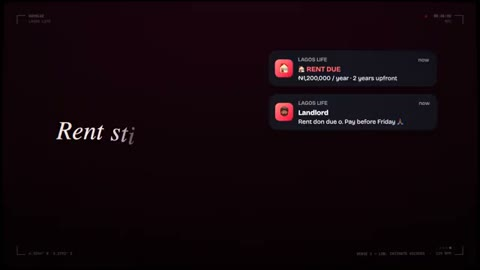

[← Back to gallery](../browse/music.en.md) · [简体中文](2110880079177777356.md)

# Lagos Life

**[Kaykluz · @kaykluz](https://x.com/kaykluz)** · Music & lyrics · 240s

> Discovery pool · Source verified; catalog details being completed.

**[▶ Open gallery to play](https://guanmo-ai.github.io/awesome-ai-motion/?lang=en#case-2110880079177777356)** · [Original post](https://x.com/kaykluz/status/2110880079177777356)

Click the cover to open the gallery and play.

Game-themed graphics, kinetic lyrics and rhythmic cuts accompany a song.

The creator has shared instructions; this catalog links to the source without redistributing the full text or translation. [Read the creator’s original](https://x.com/kaykluz/status/2110880079177777356)

Bookmarks 0 · Likes 0 · Views 38

## Source record

- Original post: [@kaykluz](https://x.com/kaykluz/status/2110880079177777356) · 2026-10-15T23:46:43+00:00
- Model attribution: Opus 5.5 · [Creator’s statement](https://x.com/kaykluz/status/2110880079177777356)
- Prompt source: [Creator post](https://x.com/kaykluz/status/2110880079177777356) · 2026-10-16 07:22 UTC
- Cover source: [Original cover source](https://x.com/kaykluz/status/2110880079177777356) · 48s
- Metrics snapshot: [Original X post](https://x.com/kaykluz/status/2110880079177777356) · 2026-10-16 07:22 UTC
- Gallery video source: [Original post media record](https://x.com/kaykluz/status/2110880079177777356) · 2026-10-16 07:22 UTC · Post/media correspondence and media response checked; external reference, no re-upload

Model attribution is based on creator statements. Prompts have not been independently rerun; sound and visuals have not received a uniform quality rating. Videos reference original post media, not our uploads; redistribution permission has not been verified.
