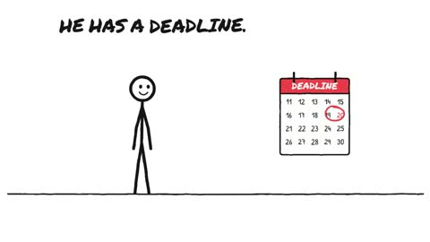

[← Back to gallery](../browse/education.en.md) · [简体中文](2110889295695253824.md)

# Procrastination Explained with Stick Figures

**[Mohmd Mc Boox · @BooxMc](https://x.com/BooxMc)** · Education & explainers · 42s

> Discovery pool · Source verified; catalog details being completed.

**[▶ Open gallery to play](https://guanmo-ai.github.io/awesome-ai-motion/?lang=en#case-2110889295695253824)** · [Original post](https://x.com/BooxMc/status/2110889295695253824)

Click the cover to open the gallery and play.

Stick-figure actions, text and scene changes explain procrastination.

No public prompt has been verified. [View the original post](https://x.com/BooxMc/status/2110889295695253824)

Bookmarks — · Likes — · Views —

## Source record

- Original post: [@BooxMc](https://x.com/BooxMc/status/2110889295695253824) · 2026-10-16T00:23:21+00:00
- Model attribution: Claude Opus 5.5 · [Creator’s statement](https://x.com/BooxMc/status/2110889295695253824)
- Prompt lookup: [Creator post](https://x.com/BooxMc/status/2110889295695253824) · 2026-11-02 09:52 UTC
- Cover source: [Original cover source](https://x.com/BooxMc/status/2110889295695253824) · 8.42s
- Metrics snapshot: [Original X post](https://x.com/BooxMc/status/2110889295695253824) · 2026-11-02 09:18 UTC
- Gallery video source: [Original post media record](https://x.com/BooxMc/status/2110889295695253824) · 2026-11-02 09:52 UTC · Post/media correspondence and media response checked; external reference, no re-upload

Model attribution is based on creator statements. Prompts have not been independently rerun; sound and visuals have not received a uniform quality rating. Videos reference original post media, not our uploads; redistribution permission has not been verified.
