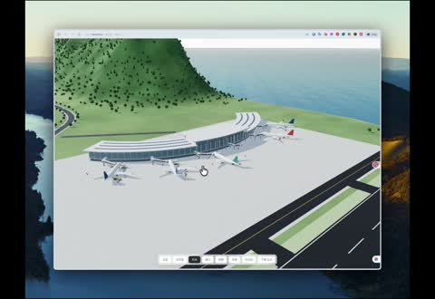

[← Back to gallery](../browse/interactive.en.md) · [简体中文](2110901063482237099.md)

# A Logistics Island in Motion

**[Ian (伊恩) · @ianneo\_ai](https://x.com/ianneo_ai)** · 3D & interactive · 33s

> Discovery pool · Source verified; catalog details being completed.

**[▶ Open gallery to play](https://guanmo-ai.github.io/awesome-ai-motion/?lang=en#case-2110901063482237099)** · [Original post](https://x.com/ianneo_ai/status/2110901063482237099)

Click the cover to open the gallery and play.

Trucks, port machinery and routes move together across a 3D logistics island.

No public prompt has been verified. [View the original post](https://x.com/ianneo_ai/status/2110901063482237099)

Bookmarks — · Likes — · Views —

## Source record

- Original post: [@ianneo\_ai](https://x.com/ianneo_ai/status/2110901063482237099) · 2026-10-16T01:10:06+00:00
- Model attribution: Claude Opus 5.5 · [Creator’s statement](https://x.com/ianneo_ai/status/2110901063482237099)
- Prompt lookup: [Creator post](https://x.com/ianneo_ai/status/2110901063482237099) · 2026-11-02 09:52 UTC
- Cover source: [Original cover source](https://x.com/ianneo_ai/status/2110901063482237099) · 6.56s
- Metrics snapshot: [Original X post](https://x.com/ianneo_ai/status/2110901063482237099) · 2026-11-02 09:19 UTC
- Gallery video source: [Original post media record](https://x.com/ianneo_ai/status/2110901063482237099) · 2026-11-02 09:52 UTC · Post/media correspondence and media response checked; external reference, no re-upload

Model attribution is based on creator statements. Prompts have not been independently rerun; sound and visuals have not received a uniform quality rating. Videos reference original post media, not our uploads; redistribution permission has not been verified.
