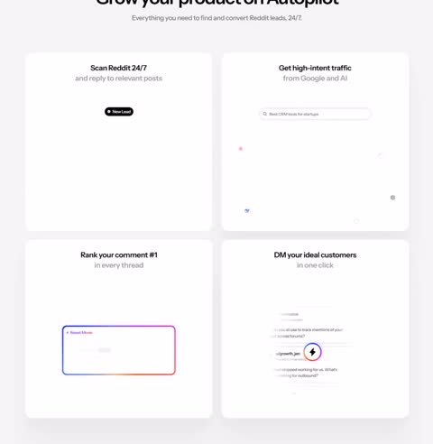

[← Back to gallery](../browse/motion.en.md) · [简体中文](2111057085454852129.md)

# Web Motion for Figma Feature Cards

**[Muhammad Talha · @xmuhammadtalha](https://x.com/xmuhammadtalha)** · Motion design · 16s

> Discovery pool · Source verified; catalog details being completed.

**[▶ Open gallery to play](https://guanmo-ai.github.io/awesome-ai-motion/?lang=en#case-2111057085454852129)** · [Original post](https://x.com/xmuhammadtalha/status/2111057085454852129)

Click the cover to open the gallery and play.

Feature cards, connections and interface elements unfold within a web section.

No public prompt has been verified. [View the original post](https://x.com/xmuhammadtalha/status/2111057085454852129)

Bookmarks — · Likes — · Views —

## Source record

- Original post: [@xmuhammadtalha](https://x.com/xmuhammadtalha/status/2111057085454852129) · 2026-10-16T11:30:05+00:00
- Model attribution: Claude Opus 5.5 · [Creator’s statement](https://x.com/xmuhammadtalha/status/2111057085454852129)
- Prompt lookup: [Creator post](https://x.com/xmuhammadtalha/status/2111057085454852129) · 2026-11-02 15:38 UTC
- Cover source: [Original cover source](https://x.com/xmuhammadtalha/status/2111057085454852129) · 3.18s
- Metrics snapshot: [Original X post](https://x.com/xmuhammadtalha/status/2111057085454852129) · 2026-11-02 15:08 UTC
- Gallery video source: [Original post media record](https://x.com/xmuhammadtalha/status/2111057085454852129) · 2026-11-02 15:38 UTC · Post/media correspondence and media response checked; external reference, no re-upload

Model attribution is based on creator statements. Prompts have not been independently rerun; sound and visuals have not received a uniform quality rating. Videos reference original post media, not our uploads; redistribution permission has not been verified.
