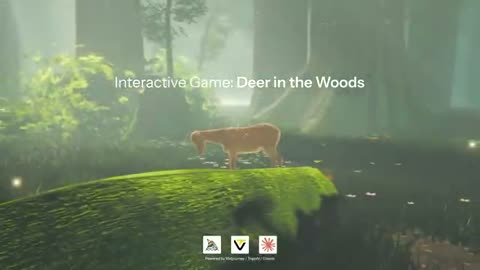

[← Back to gallery](../browse/interactive.en.md) · [简体中文](2111109914055803222.md)

# A Deer in a Misty Forest

**[Tripo · @tripoai](https://x.com/tripoai)** · 3D & interactive · 29s

> Discovery pool · Source verified; catalog details being completed.

**[▶ Open gallery to play](https://guanmo-ai.github.io/awesome-ai-motion/?lang=en#case-2111109914055803222)** · [Original post](https://x.com/tripoai/status/2111109914055803222)

Click the cover to open the gallery and play.

A deer moves through mist, light and vegetation; the creator credits Tripo for the character and Opus 5.5 for the interactive environment.

No public prompt has been verified. [View the original post](https://x.com/tripoai/status/2111109914055803222)

Bookmarks 120 · Likes 175 · Views 11,771

## Source record

- Original post: [@tripoai](https://x.com/tripoai/status/2111109914055803222) · 2026-10-16T15:00:00+00:00
- Model attribution: Opus 5.5 · [Creator’s statement](https://x.com/tripoai/status/2111109914055803222)
- Prompt lookup: [Creator post](https://x.com/tripoai/status/2111109914055803222) · 2026-10-19 09:24 UTC
- Cover source: [Original cover source](https://x.com/tripoai/status/2111109914055803222) · 5.88s
- Metrics snapshot: [Original X post](https://x.com/tripoai/status/2111109914055803222) · 2026-10-19 09:24 UTC
- Gallery video source: [Original post media record](https://x.com/tripoai/status/2111109914055803222) · 2026-10-19 09:24 UTC · Post/media correspondence and media response checked; external reference, no re-upload

Model attribution is based on creator statements. Prompts have not been independently rerun; sound and visuals have not received a uniform quality rating. Videos reference original post media, not our uploads; redistribution permission has not been verified.
