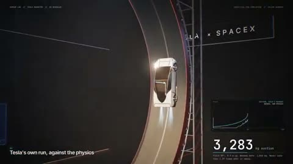

[← 返回图库](../browse/education.md) · [English](2111119619461153190.en.md)

# 倒挂 Roadster 的运动与受力

**[Konstantin Saifoulline · @konstantinsaifo](https://x.com/konstantinsaifo)** · 知识讲解 · 44s

> 发现池 · 来源已核对，编目资料待完善。

**[▶ 打开画廊播放](https://guanmo-ai.github.io/awesome-ai-motion/#case-2111119619461153190)** · [作者原帖](https://x.com/konstantinsaifo/status/2111119619461153190)

点击封面打开画廊播放。

车辆轨迹、计数与三维车体共同呈现作者的物理重建示意。

未取得作者公开提示词。 [查看作者原帖](https://x.com/konstantinsaifo/status/2111119619461153190)

收藏 6 · 点赞 7 · 浏览 2,232

## 来源记录

- 作品原帖: [@konstantinsaifo](https://x.com/konstantinsaifo/status/2111119619461153190) · 2026-10-16T15:38:34+00:00
- 模型归因: Opus 5.5 · [作者说明](https://x.com/konstantinsaifo/status/2111119619461153190)
- 提示词查阅记录: [作者原帖](https://x.com/konstantinsaifo/status/2111119619461153190) · 2026-10-19 08:47 UTC
- 封面来源: [原帖封面来源](https://x.com/konstantinsaifo/status/2111119619461153190) · 8.79s
- 互动快照: [X 原帖](https://x.com/konstantinsaifo/status/2111119619461153190) · 2026-10-19 08:47 UTC
- 画廊原视频: [原帖媒体记录](https://x.com/konstantinsaifo/status/2111119619461153190) · 2026-10-19 08:47 UTC · 已核对原帖媒体对应与媒体响应；外部引用，不重新上传

模型依据来自作者自述，未独立重跑提示词，也未对音画作统一质量评级。视频引用作者原帖媒体，未由本站重新上传，转载许可未确认。
