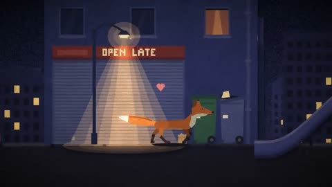

[← Back to gallery](../browse/stories.en.md) · [简体中文](2111120460561694869.md)

# Small Hours: A Cartoon Late-Night Story

**[MugaSofer · @MugaSofer](https://x.com/MugaSofer)** · Narrative films · 176s

> Discovery pool · Source verified; catalog details being completed.

**[▶ Open gallery to play](https://guanmo-ai.github.io/awesome-ai-motion/?lang=en#case-2111120460561694869)** · [Original post](https://x.com/MugaSofer/status/2111120460561694869)

Click the cover to open the gallery and play.

Cartoon characters move through nighttime streets and interiors in coded animation with Suno music.

No public prompt has been verified. [View the original post](https://x.com/MugaSofer/status/2111120460561694869)

Bookmarks — · Likes — · Views —

## Source record

- Original post: [@MugaSofer](https://x.com/MugaSofer/status/2111120460561694869) · 2026-10-16T15:41:55+00:00
- Model attribution: Claude Opus 5.5 · [Creator’s statement](https://x.com/MugaSofer/status/2111120460561694869)
- Prompt lookup: [Creator post](https://x.com/MugaSofer/status/2111120460561694869) · 2026-11-02 15:38 UTC
- Cover source: [Original cover source](https://x.com/MugaSofer/status/2111120460561694869) · 35.19s
- Metrics snapshot: [Original X post](https://x.com/MugaSofer/status/2111120460561694869) · 2026-11-02 15:05 UTC
- Gallery video source: [Original post media record](https://x.com/MugaSofer/status/2111120460561694869) · 2026-11-02 15:38 UTC · Post/media correspondence and media response checked; external reference, no re-upload

Model attribution is based on creator statements. Prompts have not been independently rerun; sound and visuals have not received a uniform quality rating. Videos reference original post media, not our uploads; redistribution permission has not been verified.
