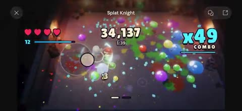

[← Back to gallery](../browse/interactive.en.md) · [简体中文](2111121904388251714.md)

# Combos and Splashes in Splat Knight

**[Sky · @code\_coded](https://x.com/code_coded)** · 3D & interactive · 23s

> Discovery pool · Source verified; catalog details being completed.

**[▶ Open gallery to play](https://guanmo-ai.github.io/awesome-ai-motion/?lang=en#case-2111121904388251714)** · [Original post](https://x.com/code_coded/status/2111121904388251714)

Click the cover to open the gallery and play.

Bright enemies and particles burst across a top-down arena, while combo numbers and popping typography reinforce each attack.

The creator has shared instructions; this catalog links to the source without redistributing the full text or translation. [Read the creator’s original](https://x.com/code_coded/status/2111121904388251714)

Bookmarks 1 · Likes 3 · Views 113

## Source record

- Original post: [@code\_coded](https://x.com/code_coded/status/2111121904388251714) · 2026-10-16T15:47:39+00:00
- Model attribution: Claude Opus 5.5 · [Creator’s statement](https://x.com/code_coded/status/2111121904388251714)
- Prompt source: [Creator post](https://x.com/code_coded/status/2111121904388251714) · 2026-10-26 15:21 UTC
- Cover source: [Original cover source](https://x.com/code_coded/status/2111121904388251714) · 4.6s
- Metrics snapshot: [Original X post](https://x.com/code_coded/status/2111121904388251714) · 2026-10-18 07:58 UTC
- Gallery video source: [Original post media record](https://x.com/code_coded/status/2111121904388251714) · 2026-10-26 15:21 UTC · Post/media correspondence and media response checked; external reference, no re-upload

Model attribution is based on creator statements. Prompts have not been independently rerun; sound and visuals have not received a uniform quality rating. Videos reference original post media, not our uploads; redistribution permission has not been verified.
