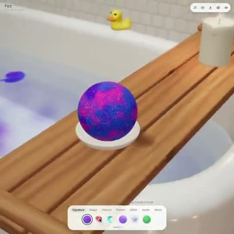

[← Back to gallery](../browse/interactive.en.md) · [简体中文](2111219143936790802.md)

# A Bath Bomb and Real-Time Fluid Color

**[Techartist · @techartist\_](https://x.com/techartist_)** · 3D & interactive · 14s

> Discovery pool · Source verified; catalog details being completed.

**[▶ Open gallery to play](https://guanmo-ai.github.io/awesome-ai-motion/?lang=en#case-2111219143936790802)** · [Original post](https://x.com/techartist_/status/2111219143936790802)

Click the cover to open the gallery and play.

[Matching project source](https://github.com/iamtechartist/bath-bomb-builder) · [Creator’s interactive demo](https://iamtechartist.github.io/bath-bomb-builder/)

An interactive bath bomb colors a bathtub through a real-time 3D fluid simulation.

## Source & web pages

- **Direct source**：[Matching project source](https://github.com/iamtechartist/bath-bomb-builder) · MIT
  The code is MIT; not independently reproduced. Asset rights are separate.
  [Link source](https://x.com/techartist_/status/2111219146109411690) · Link checked 2026-10-18 08:00 UTC
- **Public web page**：[Creator’s interactive demo](https://iamtechartist.github.io/bath-bomb-builder/)
  [Link source](https://x.com/techartist_/status/2111219146109411690) · Link checked 2026-10-18 08:00 UTC

No public prompt has been verified. [View the original post](https://x.com/techartist_/status/2111219143936790802)

Bookmarks 39 · Likes 141 · Views 5,005

## Source record

- Original post: [@techartist\_](https://x.com/techartist_/status/2111219143936790802) · 2026-10-16T22:14:03+00:00
- Model attribution: Opus 5.5 · [Creator’s statement](https://x.com/techartist_/status/2111219143936790802)
- Prompt lookup: [Creator post](https://x.com/techartist_/status/2111219143936790802) · 2026-10-19 09:12 UTC
- Cover source: [Original cover source](https://x.com/techartist_/status/2111219143936790802) · 2.88s
- Metrics snapshot: [Original X post](https://x.com/techartist_/status/2111219143936790802) · 2026-10-19 09:12 UTC
- Gallery video source: [Original post media record](https://x.com/techartist_/status/2111219143936790802) · 2026-10-19 09:12 UTC · Post/media correspondence and media response checked; external reference, no re-upload

Model attribution is based on creator statements. Prompts have not been independently rerun; sound and visuals have not received a uniform quality rating. Videos reference original post media, not our uploads; redistribution permission has not been verified.
