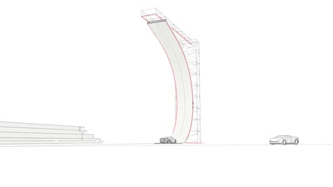

[← Back to gallery](../browse/motion.en.md) · [简体中文](2111235450035745058.md)

# A Line-Drawn Roadster Stunt

**[DreW · @devteamdrew](https://x.com/devteamdrew)** · Motion design · 18s

> Discovery pool · Source verified; catalog details being completed.

**[▶ Open gallery to play](https://guanmo-ai.github.io/awesome-ai-motion/?lang=en#case-2111235450035745058)** · [Original post](https://x.com/devteamdrew/status/2111235450035745058)

Click the cover to open the gallery and play.

A line-drawn car, ramp and dust form a stunt sequence.

No public prompt has been verified. [View the original post](https://x.com/devteamdrew/status/2111235450035745058)

Bookmarks 78 · Likes 270 · Views 38,503

## Source record

- Original post: [@devteamdrew](https://x.com/devteamdrew/status/2111235450035745058) · 2026-10-16T23:18:50+00:00
- Model attribution: Opus 5.5 · [Creator’s statement](https://x.com/devteamdrew/status/2111235450035745058)
- Prompt lookup: [Creator post](https://x.com/devteamdrew/status/2111235450035745058) · 2026-10-19 09:12 UTC
- Cover source: [Original cover source](https://x.com/devteamdrew/status/2111235450035745058) · 3.6s
- Metrics snapshot: [Original X post](https://x.com/devteamdrew/status/2111235450035745058) · 2026-10-19 09:12 UTC
- Gallery video source: [Original post media record](https://x.com/devteamdrew/status/2111235450035745058) · 2026-10-19 09:12 UTC · Post/media correspondence and media response checked; external reference, no re-upload

Model attribution is based on creator statements. Prompts have not been independently rerun; sound and visuals have not received a uniform quality rating. Videos reference original post media, not our uploads; redistribution permission has not been verified.
