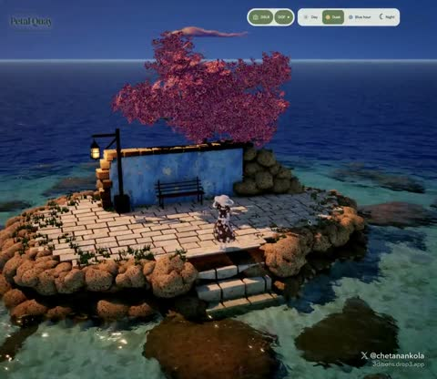

[← 返回图库](../browse/interactive.md) · [English](2111397563052237282.en.md)

# 花岸石岛的光影场景

**[Vyom · @HelloVyom](https://x.com/HelloVyom)** · 交互演示 · 38s

> 发现池 · 来源已核对，编目资料待完善。

**[▶ 打开画廊播放](https://guanmo-ai.github.io/awesome-ai-motion/#case-2111397563052237282)** · [作者原帖](https://x.com/HelloVyom/status/2111397563052237282)

点击封面打开画廊播放。

石砌小岛、花树和水面通过不同光照呈现空间层次。

未取得作者公开提示词。 [查看作者原帖](https://x.com/HelloVyom/status/2111397563052237282)

收藏 — · 点赞 — · 浏览 —

## 来源记录

- 作品原帖: [@HelloVyom](https://x.com/HelloVyom/status/2111397563052237282) · 2026-10-17T10:03:01+00:00
- 模型归因: Claude Opus 5.5 · [作者说明](https://x.com/HelloVyom/status/2111397563052237282)
- 提示词查阅记录: [作者原帖](https://x.com/HelloVyom/status/2111397563052237282) · 2026-11-03 09:18 UTC
- 封面来源: [原帖封面来源](https://x.com/HelloVyom/status/2111397563052237282) · 7.53s
- 互动快照: [X 原帖](https://x.com/HelloVyom/status/2111397563052237282) · 2026-11-03 08:38 UTC
- 画廊原视频: [原帖媒体记录](https://x.com/HelloVyom/status/2111397563052237282) · 2026-11-03 09:18 UTC · 已核对原帖媒体对应与媒体响应；外部引用，不重新上传

模型依据来自作者自述，未独立重跑提示词，也未对音画作统一质量评级。视频引用作者原帖媒体，未由本站重新上传，转载许可未确认。
