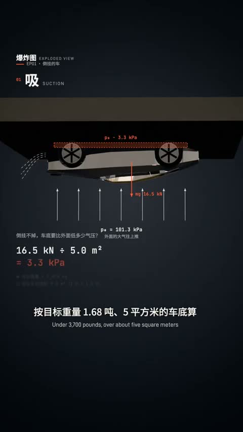

[← Back to gallery](../browse/education.en.md) · [简体中文](2111440772998599022.md)

# A Roadster Explainer with Exploded 3D Views

**[MSB · @KeWai386772](https://x.com/KeWai386772)** · Education & explainers · 174s

> Discovery pool · Source verified; catalog details being completed.

**[▶ Open gallery to play](https://guanmo-ai.github.io/awesome-ai-motion/?lang=en#case-2111440772998599022)** · [Original post](https://x.com/KeWai386772/status/2111440772998599022)

Click the cover to open the gallery and play.

The body, chassis and drivetrain separate alongside text and plots in a Roadster explainer credited to Opus 5.5.

No public prompt has been verified. [View the original post](https://x.com/KeWai386772/status/2111440772998599022)

Bookmarks 122 · Likes 124 · Views 12,135

## Source record

- Original post: [@KeWai386772](https://x.com/KeWai386772/status/2111440772998599022) · 2026-10-17T12:54:43+00:00
- Model attribution: Claude Opus 5.5 · [Creator’s statement](https://x.com/KeWai386772/status/2111440772998599022)
- Prompt lookup: [Creator post](https://x.com/KeWai386772/status/2111440772998599022) · 2026-10-21 09:54 UTC
- Cover source: [Original cover source](https://x.com/KeWai386772/status/2111440772998599022) · 34.71s
- Metrics snapshot: [Original X post](https://x.com/KeWai386772/status/2111440772998599022) · 2026-10-21 09:54 UTC
- Gallery video source: [Original post media record](https://x.com/KeWai386772/status/2111440772998599022) · 2026-10-21 09:54 UTC · Post/media correspondence and media response checked; external reference, no re-upload

Model attribution is based on creator statements. Prompts have not been independently rerun; sound and visuals have not received a uniform quality rating. Videos reference original post media, not our uploads; redistribution permission has not been verified.
