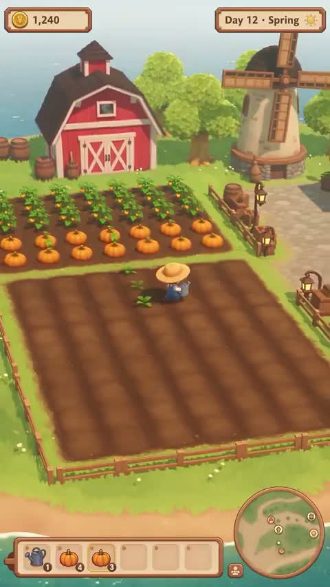

[← Back to gallery](../browse/characters.en.md) · [简体中文](2111458380854296639.md)

# Planting and Seasons on a Small Farm

**[sorenxet · @sorenxet](https://x.com/sorenxet)** · Pixel art & characters · 15s

> Discovery pool · Source verified; catalog details being completed.

**[▶ Watch on X](https://x.com/sorenxet/status/2111458380854296639)**

Click the cover to watch on X.

A cartoon farm shows planting, watering, harvesting and a market as seasons and light change. The creator assigns systems to Opus 5.5, the world to Unity and models to Tripo.

## What to learn

Build the world, assets and game systems separately, testing one playable system before adding the next.

**Try it yourself** · Editorial suggestions based on public source material, not a complete record of the creator’s process.

1. Define a small planting, watering, harvesting and trading loop.
2. Prepare assets and the scene, then implement systems separately.
3. Play the result and fix a written list of issues.

Tools mentioned in the source：Opus 5.5 · Unity 6 · Blender · Tripo

[Source 1](https://x.com/sorenxet/status/2111458380854296639)

No public prompt has been verified. [View the original post](https://x.com/sorenxet/status/2111458380854296639)

Bookmarks 189 · Likes 196 · Views 41,483

## Source record

- Original post: [@sorenxet](https://x.com/sorenxet/status/2111458380854296639) · 2026-10-17T14:04:41+00:00
- Model attribution: Claude Opus 5.5 · [Creator’s statement](https://x.com/sorenxet/status/2111458380854296639)
- Prompt lookup: [Creator post](https://x.com/sorenxet/status/2111458380854296639) · 2026-10-20 17:09 UTC
- Cover source: [Original cover source](https://x.com/sorenxet/status/2111458380854296639) · 3.03s
- Metrics snapshot: [Original X post](https://x.com/sorenxet/status/2111458380854296639) · 2026-10-20 17:09 UTC

Model attribution is based on creator statements. Prompts have not been independently rerun; sound and visuals have not received a uniform quality rating. Videos reference original post media, not our uploads; redistribution permission has not been verified.
