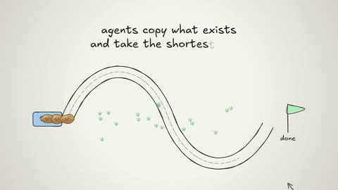

[← Back to gallery](../browse/education.en.md) · [简体中文](2111458857902043188.md)

# Hand-Drawn Explainer on Agentic Coding

**[zcw · @zwb44](https://x.com/zwb44)** · Education & explainers · 59s

> Discovery pool · Source verified; catalog details being completed.

**[▶ Open gallery to play](https://guanmo-ai.github.io/awesome-ai-motion/?lang=en#case-2111458857902043188)** · [Original post](https://x.com/zwb44/status/2111458857902043188)

Click the cover to open the gallery and play.

Paths, notes and simplified interface diagrams explain an agentic coding workflow.

No public prompt has been verified. [View the original post](https://x.com/zwb44/status/2111458857902043188)

Bookmarks — · Likes — · Views —

## Source record

- Original post: [@zwb44](https://x.com/zwb44/status/2111458857902043188) · 2026-10-17T14:06:35+00:00
- Model attribution: Claude Opus 5.5 · [Creator’s statement](https://x.com/zwb44/status/2111458857902043188)
- Prompt lookup: [Creator post](https://x.com/zwb44/status/2111458857902043188) · 2026-11-03 09:18 UTC
- Cover source: [Original cover source](https://x.com/zwb44/status/2111458857902043188) · 11.71s
- Metrics snapshot: [Original X post](https://x.com/zwb44/status/2111458857902043188) · 2026-11-03 08:38 UTC
- Gallery video source: [Original post media record](https://x.com/zwb44/status/2111458857902043188) · 2026-11-03 09:18 UTC · Post/media correspondence and media response checked; external reference, no re-upload

Model attribution is based on creator statements. Prompts have not been independently rerun; sound and visuals have not received a uniform quality rating. Videos reference original post media, not our uploads; redistribution permission has not been verified.
