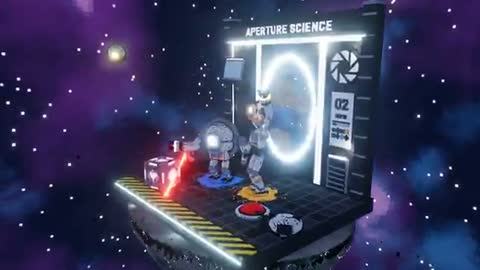

[← Back to gallery](../browse/characters.en.md) · [简体中文](2111524747037278651.md)

# Voxel Portal Laboratory

**[Sad AlbertX · @SadAlbert10](https://x.com/SadAlbert10)** · Pixel art & characters · 56s

> Discovery pool · Source verified; catalog details being completed.

**[▶ Open gallery to play](https://guanmo-ai.github.io/awesome-ai-motion/?lang=en#case-2111524747037278651)** · [Original post](https://x.com/SadAlbert10/status/2111524747037278651)

Click the cover to open the gallery and play.

Voxel architecture, glowing portals and orbiting views form a spatial showcase.

No public prompt has been verified. [View the original post](https://x.com/SadAlbert10/status/2111524747037278651)

Bookmarks 10 · Likes 54 · Views 5,222

## Source record

- Original post: [@SadAlbert10](https://x.com/SadAlbert10/status/2111524747037278651) · 2026-10-17T18:28:24+00:00
- Model attribution: Opus 5.5 · [Creator’s statement](https://x.com/SadAlbert10/status/2111524747037278651)
- Prompt lookup: [Creator post](https://x.com/SadAlbert10/status/2111524747037278651) · 2026-10-19 09:12 UTC
- Cover source: [Original cover source](https://x.com/SadAlbert10/status/2111524747037278651) · 11.2s
- Metrics snapshot: [Original X post](https://x.com/SadAlbert10/status/2111524747037278651) · 2026-10-19 09:12 UTC
- Gallery video source: [Original post media record](https://x.com/SadAlbert10/status/2111524747037278651) · 2026-10-19 09:12 UTC · Post/media correspondence and media response checked; external reference, no re-upload

Model attribution is based on creator statements. Prompts have not been independently rerun; sound and visuals have not received a uniform quality rating. Videos reference original post media, not our uploads; redistribution permission has not been verified.
