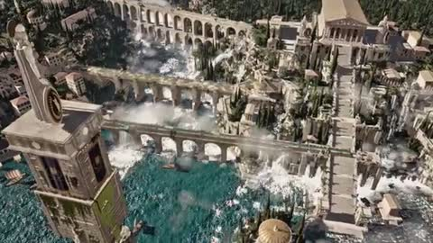

[← 返回图库](../browse/interactive.md) · [English](2111582260818239777.en.md)

# Athenaion：代码生成的古希腊世界

**[Leon Lin · @LexnLin](https://x.com/LexnLin)** · 交互演示 · 54s

> 发现池 · 来源已核对，编目资料待完善。

**[▶ 打开画廊播放](https://guanmo-ai.github.io/awesome-ai-motion/#case-2111582260818239777)** · [作者原帖](https://x.com/LexnLin/status/2111582260818239777)

点击封面打开画廊播放。

[Athenaion 场景工程](https://github.com/Leonxlnx/athenaion)

神庙、水道、瀑布与石雕构成代码生成的三维世界。

## 源码与网页

- **直接源码**：[Athenaion 场景工程](https://github.com/Leonxlnx/athenaion) · MIT
  工程代码为 MIT；参考图等素材的权利单独核对。
  [链接出处](https://x.com/LexnLin/status/2111592989545951522) · 链接核对 2026-10-18 08:02 UTC

未取得作者公开提示词。 [查看作者原帖](https://x.com/LexnLin/status/2111582260818239777)

收藏 1,280 · 点赞 3,133 · 浏览 201,510

## 来源记录

- 作品原帖: [@LexnLin](https://x.com/LexnLin/status/2111582260818239777) · 2026-10-17T22:16:56+00:00
- 模型归因: Opus 5.5 · [作者说明](https://x.com/LexnLin/status/2111582260818239777)
- 提示词查阅记录: [作者原帖](https://x.com/LexnLin/status/2111582260818239777) · 2026-10-19 09:12 UTC
- 封面来源: [原帖封面来源](https://x.com/LexnLin/status/2111582260818239777) · 10.86s
- 互动快照: [X 原帖](https://x.com/LexnLin/status/2111582260818239777) · 2026-10-19 09:12 UTC
- 画廊原视频: [原帖媒体记录](https://x.com/LexnLin/status/2111582260818239777) · 2026-10-19 09:12 UTC · 已核对原帖媒体对应与媒体响应；外部引用，不重新上传

模型依据来自作者自述，未独立重跑提示词，也未对音画作统一质量评级。视频引用作者原帖媒体，未由本站重新上传，转载许可未确认。
