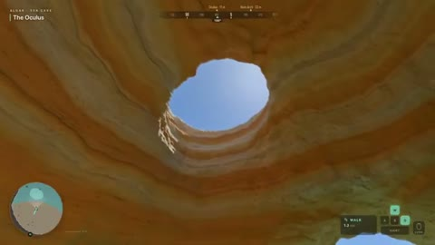

[← Back to gallery](../browse/interactive.en.md) · [简体中文](2111912410131153254.md)

# A Procedural Coastal Cave and Sea

**[Techartist · @techartist\_](https://x.com/techartist_)** · 3D & interactive · 16s

> Discovery pool · Source verified; catalog details being completed.

**[▶ Open gallery to play](https://guanmo-ai.github.io/awesome-ai-motion/?lang=en#case-2111912410131153254)** · [Original post](https://x.com/techartist_/status/2111912410131153254)

Click the cover to open the gallery and play.

A coded coast, cave and sea with a navigation interface.

No public prompt has been verified. [View the original post](https://x.com/techartist_/status/2111912410131153254)

Bookmarks 183 · Likes 372 · Views 13,648

## Source record

- Original post: [@techartist\_](https://x.com/techartist_/status/2111912410131153254) · 2026-10-18T20:08:50+00:00
- Model attribution: Opus 5.5 · [Creator’s statement](https://x.com/techartist_/status/2111912410131153254)
- Prompt lookup: [Creator post](https://x.com/techartist_/status/2111912410131153254) · 2026-10-19 09:12 UTC
- Cover source: [Original cover source](https://x.com/techartist_/status/2111912410131153254) · 3.2s
- Metrics snapshot: [Original X post](https://x.com/techartist_/status/2111912410131153254) · 2026-10-19 09:12 UTC
- Gallery video source: [Original post media record](https://x.com/techartist_/status/2111912410131153254) · 2026-10-19 09:12 UTC · Post/media correspondence and media response checked; external reference, no re-upload

Model attribution is based on creator statements. Prompts have not been independently rerun; sound and visuals have not received a uniform quality rating. Videos reference original post media, not our uploads; redistribution permission has not been verified.
