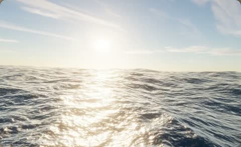

[← Back to gallery](../browse/interactive.en.md) · [简体中文](2111920496208204235.md)

# A Procedural Ocean in a Small File

**[AmirMušić · @AmirMushich](https://x.com/AmirMushich)** · 3D & interactive · 19s

> Discovery pool · Source verified; catalog details being completed.

**[▶ Open gallery to play](https://guanmo-ai.github.io/awesome-ai-motion/?lang=en#case-2111920496208204235)** · [Original post](https://x.com/AmirMushich/status/2111920496208204235)

Click the cover to open the gallery and play.

Waves, reflections and sky colors form a real-time ocean scene.

No public prompt has been verified. [View the original post](https://x.com/AmirMushich/status/2111920496208204235)

Bookmarks — · Likes — · Views —

## Source record

- Original post: [@AmirMushich](https://x.com/AmirMushich/status/2111920496208204235) · 2026-10-18T20:40:58+00:00
- Model attribution: Claude Opus 5.5 · [Creator’s statement](https://x.com/AmirMushich/status/2111920496208204235)
- Prompt lookup: [Creator post](https://x.com/AmirMushich/status/2111920496208204235) · 2026-11-02 09:52 UTC
- Cover source: [Original cover source](https://x.com/AmirMushich/status/2111920496208204235) · 3.81s
- Metrics snapshot: [Original X post](https://x.com/AmirMushich/status/2111920496208204235) · 2026-11-02 09:15 UTC
- Gallery video source: [Original post media record](https://x.com/AmirMushich/status/2111920496208204235) · 2026-11-02 09:52 UTC · Post/media correspondence and media response checked; external reference, no re-upload

Model attribution is based on creator statements. Prompts have not been independently rerun; sound and visuals have not received a uniform quality rating. Videos reference original post media, not our uploads; redistribution permission has not been verified.
