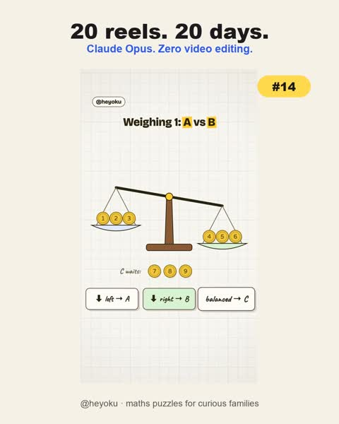

[← Back to gallery](../browse/education.en.md) · [简体中文](2112173194031587405.md)

# Math Puzzles in Numbers and Scales

**[Shivangi Srivastava · @shivangi\_sriv](https://x.com/shivangi_sriv)** · Education & explainers · 15s

> Discovery pool · Source verified; catalog details being completed.

**[▶ Open gallery to play](https://guanmo-ai.github.io/awesome-ai-motion/?lang=en#case-2112173194031587405)** · [Original post](https://x.com/shivangi_sriv/status/2112173194031587405)

Click the cover to open the gallery and play.

Numbers, scales and timing marks appear in a coded math-puzzle reel.

No public prompt has been verified. [View the original post](https://x.com/shivangi_sriv/status/2112173194031587405)

Bookmarks — · Likes — · Views —

## Source record

- Original post: [@shivangi\_sriv](https://x.com/shivangi_sriv/status/2112173194031587405) · 2026-10-19T13:25:06+00:00
- Model attribution: Claude Opus 5.5 · [Creator’s statement](https://x.com/shivangi_sriv/status/2112173194031587405)
- Prompt lookup: [Creator post](https://x.com/shivangi_sriv/status/2112173194031587405) · 2026-11-02 15:38 UTC
- Cover source: [Original cover source](https://x.com/shivangi_sriv/status/2112173194031587405) · 3s
- Metrics snapshot: [Original X post](https://x.com/shivangi_sriv/status/2112173194031587405) · 2026-11-02 15:08 UTC
- Gallery video source: [Original post media record](https://x.com/shivangi_sriv/status/2112173194031587405) · 2026-11-02 15:38 UTC · Post/media correspondence and media response checked; external reference, no re-upload

Model attribution is based on creator statements. Prompts have not been independently rerun; sound and visuals have not received a uniform quality rating. Videos reference original post media, not our uploads; redistribution permission has not been verified.
