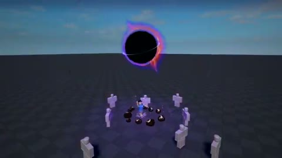

[← 返回图库](../browse/motion.md) · [English](2112324937872490552.en.md)

# 黑洞与能量环的游戏特效

**[John Kler · @JohnKlerAI](https://x.com/JohnKlerAI)** · 短动效 · 11s

> 发现池 · 来源已核对，编目资料待完善。

**[▶ 打开画廊播放](https://guanmo-ai.github.io/awesome-ai-motion/#case-2112324937872490552)** · [作者原帖](https://x.com/JohnKlerAI/status/2112324937872490552)

点击封面打开画廊播放。

黑色球体、发光环和电弧在游戏场地中扩张，围绕简化角色形成技能特效。

未取得作者公开提示词。 [查看作者原帖](https://x.com/JohnKlerAI/status/2112324937872490552)

收藏 80 · 点赞 189 · 浏览 7,470

## 来源记录

- 作品原帖: [@JohnKlerAI](https://x.com/JohnKlerAI/status/2112324937872490552) · 2026-10-19T23:28:04+00:00
- 模型归因: Claude Opus 5.5 · [作者说明](https://x.com/JohnKlerAI/status/2112324937872490552)
- 提示词查阅记录: [作者原帖](https://x.com/JohnKlerAI/status/2112324937872490552) · 2026-10-26 06:34 UTC
- 封面来源: [原帖封面来源](https://x.com/JohnKlerAI/status/2112324937872490552) · 2.22s
- 互动快照: [X 原帖](https://x.com/JohnKlerAI/status/2112324937872490552) · 2026-10-26 06:34 UTC
- 画廊原视频: [原帖媒体记录](https://x.com/JohnKlerAI/status/2112324937872490552) · 2026-10-26 06:34 UTC · 已核对原帖媒体对应与媒体响应；外部引用，不重新上传

模型依据来自作者自述，未独立重跑提示词，也未对音画作统一质量评级。视频引用作者原帖媒体，未由本站重新上传，转载许可未确认。
