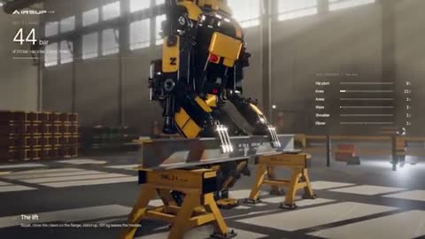

[← 返回图库](../browse/interactive.md) · [English](2112477830046957818.en.md)

# 巨型机器人的物理工作测试

**[Konstantin Saifoulline · @konstantinsaifo](https://x.com/konstantinsaifo)** · 交互演示 · 38s

> 发现池 · 来源已核对，编目资料待完善。

**[▶ 打开画廊播放](https://guanmo-ai.github.io/awesome-ai-motion/#case-2112477830046957818)** · [作者原帖](https://x.com/konstantinsaifo/status/2112477830046957818)

点击封面打开画廊播放。

大型机器人在工厂内行走并推动物体，结合关节、油液和受力显示运动；作者说明用 Opus 5.5、Three.js 与 Airsup 构建。

未取得作者公开提示词。 [查看作者原帖](https://x.com/konstantinsaifo/status/2112477830046957818)

收藏 9 · 点赞 27 · 浏览 5,313

## 来源记录

- 作品原帖: [@konstantinsaifo](https://x.com/konstantinsaifo/status/2112477830046957818) · 2026-10-20T09:35:37+00:00
- 模型归因: Claude Opus 5.5 · [作者说明](https://x.com/konstantinsaifo/status/2112477830046957818)
- 提示词查阅记录: [作者原帖](https://x.com/konstantinsaifo/status/2112477830046957818) · 2026-10-20 15:51 UTC
- 封面来源: [原帖封面来源](https://x.com/konstantinsaifo/status/2112477830046957818) · 7.59s
- 互动快照: [X 原帖](https://x.com/konstantinsaifo/status/2112477830046957818) · 2026-10-20 15:51 UTC
- 画廊原视频: [原帖媒体记录](https://x.com/konstantinsaifo/status/2112477830046957818) · 2026-10-20 15:51 UTC · 已核对原帖媒体对应与媒体响应；外部引用，不重新上传

模型依据来自作者自述，未独立重跑提示词，也未对音画作统一质量评级。视频引用作者原帖媒体，未由本站重新上传，转载许可未确认。
