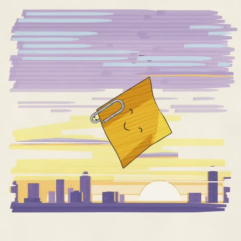

[← Back to gallery](../browse/stories.en.md) · [简体中文](2112584730856366140.md)

# A Paperclip and Sticky Note Short

**[Kevin Ngo · @kevin\_t\_ngo](https://x.com/kevin_t_ngo)** · Narrative films · 60s

> Discovery pool · Source verified; catalog details being completed.

**[▶ Open gallery to play](https://guanmo-ai.github.io/awesome-ai-motion/?lang=en#case-2112584730856366140)** · [Original post](https://x.com/kevin_t_ngo/status/2112584730856366140)

Click the cover to open the gallery and play.

A paperclip and a sticky note carry a small story through drawn and 3D scenes.

No public prompt has been verified. [View the original post](https://x.com/kevin_t_ngo/status/2112584730856366140)

Bookmarks — · Likes — · Views —

## Source record

- Original post: [@kevin\_t\_ngo](https://x.com/kevin_t_ngo/status/2112584730856366140) · 2026-10-20T16:40:24+00:00
- Model attribution: Claude Opus 5.5 · [Creator’s statement](https://x.com/kevin_t_ngo/status/2112584730856366140)
- Prompt lookup: [Creator post](https://x.com/kevin_t_ngo/status/2112584730856366140) · 2026-11-03 09:18 UTC
- Cover source: [Original cover source](https://x.com/kevin_t_ngo/status/2112584730856366140) · 41.74s
- Metrics snapshot: [Original X post](https://x.com/kevin_t_ngo/status/2112584730856366140) · 2026-11-03 08:38 UTC
- Gallery video source: [Original post media record](https://x.com/kevin_t_ngo/status/2112584730856366140) · 2026-11-03 09:18 UTC · Post/media correspondence and media response checked; external reference, no re-upload

Model attribution is based on creator statements. Prompts have not been independently rerun; sound and visuals have not received a uniform quality rating. Videos reference original post media, not our uploads; redistribution permission has not been verified.
