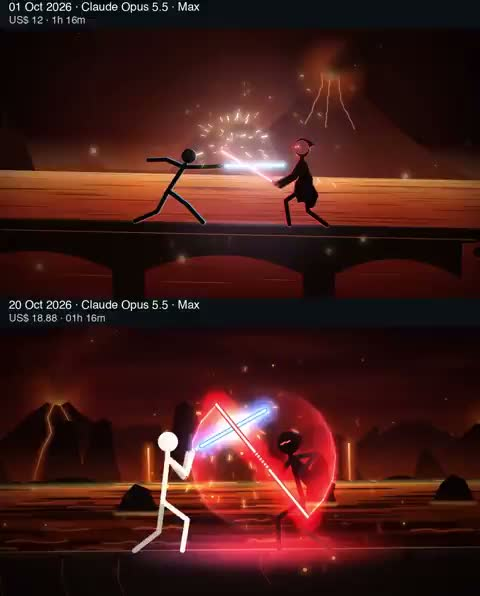

[← Back to gallery](../browse/characters.en.md) · [简体中文](2112700824220832140.md)

# Two Runs of a Stickman Lightsaber Duel

**[Daniel Zambrini · @DanielZambrini](https://x.com/DanielZambrini)** · Pixel art & characters · 15s

> Discovery pool · Source verified; catalog details being completed.

**[▶ Open gallery to play](https://guanmo-ai.github.io/awesome-ai-motion/?lang=en#case-2112700824220832140)** · [Original post](https://x.com/DanielZambrini/status/2112700824220832140)

Click the cover to open the gallery and play.

Stacked views compare two stickman duels through lightsaber trails, jumps and a lava-lit setting.

No public prompt has been verified. [View the original post](https://x.com/DanielZambrini/status/2112700824220832140)

Bookmarks 129 · Likes 203 · Views 35,230

## Source record

- Original post: [@DanielZambrini](https://x.com/DanielZambrini/status/2112700824220832140) · 2026-10-21T00:21:43+00:00
- Model attribution: Claude Opus 5.5 · [Creator’s statement](https://x.com/DanielZambrini/status/2112700824220832140)
- Prompt lookup: [Creator post](https://x.com/DanielZambrini/status/2112700824220832140) · 2026-10-24 12:20 UTC
- Cover source: [Original cover source](https://x.com/DanielZambrini/status/2112700824220832140) · 3s
- Metrics snapshot: [Original X post](https://x.com/DanielZambrini/status/2112700824220832140) · 2026-10-24 12:20 UTC
- Gallery video source: [Original post media record](https://x.com/DanielZambrini/status/2112700824220832140) · 2026-10-24 12:20 UTC · Post/media correspondence and media response checked; external reference, no re-upload

Model attribution is based on creator statements. Prompts have not been independently rerun; sound and visuals have not received a uniform quality rating. Videos reference original post media, not our uploads; redistribution permission has not been verified.
