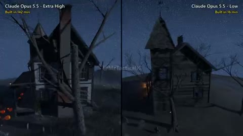

[← 返回图库](../browse/interactive.md) · [English](2112756630203011516.en.md)

# 两种推理强度下的鬼屋

**[Mr Tactical · @MrTacticalX](https://x.com/MrTacticalX)** · 交互演示 · 46s

> 发现池 · 来源已核对，编目资料待完善。

**[▶ 打开画廊播放](https://guanmo-ai.github.io/awesome-ai-motion/#case-2112756630203011516)** · [作者原帖](https://x.com/MrTacticalX/status/2112756630203011516)

点击封面打开画廊播放。

并排的程序化鬼屋用枯树、蝙蝠与旋转镜头展示同一模型不同推理强度的场景结果。

未取得作者公开提示词。 [查看作者原帖](https://x.com/MrTacticalX/status/2112756630203011516)

收藏 140 · 点赞 343 · 浏览 37,810

## 来源记录

- 作品原帖: [@MrTacticalX](https://x.com/MrTacticalX/status/2112756630203011516) · 2026-10-21T04:03:28+00:00
- 模型归因: Claude Opus 5.5 · [作者说明](https://x.com/MrTacticalX/status/2112756630203011516)
- 提示词查阅记录: [作者原帖](https://x.com/MrTacticalX/status/2112756630203011516) · 2026-10-24 12:20 UTC
- 封面来源: [原帖封面来源](https://x.com/MrTacticalX/status/2112756630203011516) · 9.1s
- 互动快照: [X 原帖](https://x.com/MrTacticalX/status/2112756630203011516) · 2026-10-24 12:20 UTC
- 画廊原视频: [原帖媒体记录](https://x.com/MrTacticalX/status/2112756630203011516) · 2026-10-24 12:20 UTC · 已核对原帖媒体对应与媒体响应；外部引用，不重新上传

模型依据来自作者自述，未独立重跑提示词，也未对音画作统一质量评级。视频引用作者原帖媒体，未由本站重新上传，转载许可未确认。
