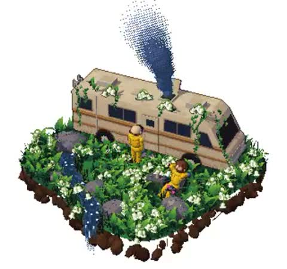

[← Back to gallery](../browse/characters.en.md) · [简体中文](2112897537430741143.md)

# Cooking on a Lily-of-the-Valley Island

**[Ann Nguyen · @ann\_nnng](https://x.com/ann_nnng)** · Pixel art & characters · 24s

> Discovery pool · Source verified; catalog details being completed.

**[▶ Open gallery to play](https://guanmo-ai.github.io/awesome-ai-motion/?lang=en#case-2112897537430741143)** · [Original post](https://x.com/ann_nnng/status/2112897537430741143)

Click the cover to open the gallery and play.

Flowers surround a camper and two cartoon figures on a tiny island, with dotted cooking smoke rising above the scene.

No public prompt has been verified. [View the original post](https://x.com/ann_nnng/status/2112897537430741143)

Bookmarks 139 · Likes 258 · Views 7,619

## Source record

- Original post: [@ann\_nnng](https://x.com/ann_nnng/status/2112897537430741143) · 2026-10-21T13:23:23+00:00
- Model attribution: Claude Opus 5.5 · [Creator’s statement](https://x.com/ann_nnng/status/2112897537430741143)
- Prompt lookup: [Creator post](https://x.com/ann_nnng/status/2112897537430741143) · 2026-10-22 08:51 UTC
- Cover source: [Original cover source](https://x.com/ann_nnng/status/2112897537430741143) · 4.8s
- Metrics snapshot: [Original X post](https://x.com/ann_nnng/status/2112897537430741143) · 2026-10-22 08:51 UTC
- Gallery video source: [Original post media record](https://x.com/ann_nnng/status/2112897537430741143) · 2026-10-22 08:51 UTC · Post/media correspondence and media response checked; external reference, no re-upload

Model attribution is based on creator statements. Prompts have not been independently rerun; sound and visuals have not received a uniform quality rating. Videos reference original post media, not our uploads; redistribution permission has not been verified.
