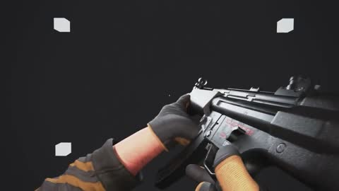

[← Back to gallery](../browse/interactive.en.md) · [简体中文](2112931493043687763.md)

# A First-Person Weapon Animation in Blender

**[O🌷 · @Octoberry](https://x.com/Octoberry)** · 3D & interactive · 44s

> Discovery pool · Source verified; catalog details being completed.

**[▶ Open gallery to play](https://guanmo-ai.github.io/awesome-ai-motion/?lang=en#case-2112931493043687763)** · [Original post](https://x.com/Octoberry/status/2112931493043687763)

Click the cover to open the gallery and play.

A weapon and gloves demonstrate raising, aiming and mechanical motion in an animated game asset.

No public prompt has been verified. [View the original post](https://x.com/Octoberry/status/2112931493043687763)

Bookmarks — · Likes — · Views —

## Source record

- Original post: [@Octoberry](https://x.com/Octoberry/status/2112931493043687763) · 2026-10-21T15:38:18+00:00
- Model attribution: Claude Opus 5.5 · [Creator’s statement](https://x.com/Octoberry/status/2112931493043687763)
- Prompt lookup: [Creator post](https://x.com/Octoberry/status/2112931493043687763) · 2026-11-02 15:38 UTC
- Cover source: [Original cover source](https://x.com/Octoberry/status/2112931493043687763) · 8.85s
- Metrics snapshot: [Original X post](https://x.com/Octoberry/status/2112931493043687763) · 2026-11-02 15:08 UTC
- Gallery video source: [Original post media record](https://x.com/Octoberry/status/2112931493043687763) · 2026-11-02 15:38 UTC · Post/media correspondence and media response checked; external reference, no re-upload

Model attribution is based on creator statements. Prompts have not been independently rerun; sound and visuals have not received a uniform quality rating. Videos reference original post media, not our uploads; redistribution permission has not been verified.
