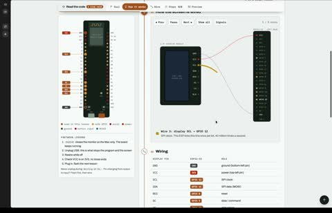

[← Back to gallery](../browse/education.en.md) · [简体中文](2113003653644619955.md)

# An Interactive ESP32 Pin-and-Signal Lab

**[Abderrahmen Gharsallah · @abderrahmen\_g](https://x.com/abderrahmen_g)** · Education & explainers · 66s

> Discovery pool · Source verified; catalog details being completed.

**[▶ Open gallery to play](https://guanmo-ai.github.io/awesome-ai-motion/?lang=en#case-2113003653644619955)** · [Original post](https://x.com/abderrahmen_g/status/2113003653644619955)

Click the cover to open the gallery and play.

[ESP32 interactive-lab site source](https://github.com/agharsallah/esp-labs-web) · [ESP32 interactive lab](https://esp-labs-web.vercel.app/)

Pin connections, components and signal traces accompany exercises in hardware wiring and changing data.

## Source & web pages

- **Direct source**：[ESP32 interactive-lab site source](https://github.com/agharsallah/esp-labs-web) · [MIT](https://github.com/agharsallah/esp-labs-web/blob/main/LICENSE)
  [Link source](https://x.com/abderrahmen_g/status/2113003653644619955) · Link checked 2026-11-02 09:52 UTC
- **Public web page**：[ESP32 interactive lab](https://esp-labs-web.vercel.app/)
  [Link source](https://github.com/agharsallah/esp-labs-web) · Link checked 2026-11-02 09:52 UTC

No public prompt has been verified. [View the original post](https://x.com/abderrahmen_g/status/2113003653644619955)

Bookmarks — · Likes — · Views —

## Source record

- Original post: [@abderrahmen\_g](https://x.com/abderrahmen_g/status/2113003653644619955) · 2026-10-21T20:25:03+00:00
- Model attribution: Claude Opus 5.5 · [Creator’s statement](https://x.com/abderrahmen_g/status/2113003653644619955)
- Prompt lookup: [Creator post](https://x.com/abderrahmen_g/status/2113003653644619955) · 2026-11-02 09:52 UTC
- Cover source: [Original cover source](https://x.com/abderrahmen_g/status/2113003653644619955) · 13.16s
- Metrics snapshot: [Original X post](https://x.com/abderrahmen_g/status/2113003653644619955) · 2026-11-02 09:15 UTC
- Gallery video source: [Original post media record](https://x.com/abderrahmen_g/status/2113003653644619955) · 2026-11-02 09:52 UTC · Post/media correspondence and media response checked; external reference, no re-upload

Model attribution is based on creator statements. Prompts have not been independently rerun; sound and visuals have not received a uniform quality rating. Videos reference original post media, not our uploads; redistribution permission has not been verified.
