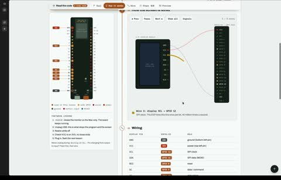

[← 返回图库](../browse/education.md) · [English](2113003653644619955.en.md)

# ESP32 引脚与信号的交互学习台

**[Abderrahmen Gharsallah · @abderrahmen\_g](https://x.com/abderrahmen_g)** · 知识讲解 · 66s

> 发现池 · 来源已核对，编目资料待完善。

**[▶ 打开画廊播放](https://guanmo-ai.github.io/awesome-ai-motion/#case-2113003653644619955)** · [作者原帖](https://x.com/abderrahmen_g/status/2113003653644619955)

点击封面打开画廊播放。

[ESP32 交互实验站代码](https://github.com/agharsallah/esp-labs-web) · [ESP32 交互实验站](https://esp-labs-web.vercel.app/)

引脚连线、器件和信号波形配合练习，演示硬件连接与数据变化。

## 源码与网页

- **直接源码**：[ESP32 交互实验站代码](https://github.com/agharsallah/esp-labs-web) · [MIT](https://github.com/agharsallah/esp-labs-web/blob/main/LICENSE)
  [链接出处](https://x.com/abderrahmen_g/status/2113003653644619955) · 链接核对 2026-11-02 09:52 UTC
- **公开网页**：[ESP32 交互实验站](https://esp-labs-web.vercel.app/)
  [链接出处](https://github.com/agharsallah/esp-labs-web) · 链接核对 2026-11-02 09:52 UTC

未取得作者公开提示词。 [查看作者原帖](https://x.com/abderrahmen_g/status/2113003653644619955)

收藏 — · 点赞 — · 浏览 —

## 来源记录

- 作品原帖: [@abderrahmen\_g](https://x.com/abderrahmen_g/status/2113003653644619955) · 2026-10-21T20:25:03+00:00
- 模型归因: Claude Opus 5.5 · [作者说明](https://x.com/abderrahmen_g/status/2113003653644619955)
- 提示词查阅记录: [作者原帖](https://x.com/abderrahmen_g/status/2113003653644619955) · 2026-11-02 09:52 UTC
- 封面来源: [原帖封面来源](https://x.com/abderrahmen_g/status/2113003653644619955) · 13.16s
- 互动快照: [X 原帖](https://x.com/abderrahmen_g/status/2113003653644619955) · 2026-11-02 09:15 UTC
- 画廊原视频: [原帖媒体记录](https://x.com/abderrahmen_g/status/2113003653644619955) · 2026-11-02 09:52 UTC · 已核对原帖媒体对应与媒体响应；外部引用，不重新上传

模型依据来自作者自述，未独立重跑提示词，也未对音画作统一质量评级。视频引用作者原帖媒体，未由本站重新上传，转载许可未确认。
