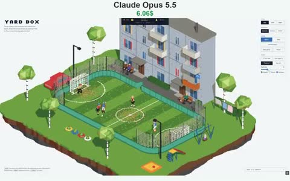

[← Back to gallery](../browse/characters.en.md) · [简体中文](2113037013326627200.md)

# Football in a Pixel Apartment Yard

**[NinjaCodex · @N1njaCodex](https://x.com/N1njaCodex)** · Pixel art & characters · 19s

> Discovery pool · Source verified; catalog details being completed.

**[▶ Open gallery to play](https://guanmo-ai.github.io/awesome-ai-motion/?lang=en#case-2113037013326627200)** · [Original post](https://x.com/N1njaCodex/status/2113037013326627200)

Click the cover to open the gallery and play.

A pitch, apartment building and trees form a miniature yard animated by ball-chasing characters, bounces and day-to-night lighting.

No public prompt has been verified. [View the original post](https://x.com/N1njaCodex/status/2113037013326627200)

Bookmarks 241 · Likes 367 · Views 9,666

## Source record

- Original post: [@N1njaCodex](https://x.com/N1njaCodex/status/2113037013326627200) · 2026-10-21T22:37:36+00:00
- Model attribution: Claude Opus 5.5 · [Creator’s statement](https://x.com/N1njaCodex/status/2113037013326627200)
- Prompt lookup: [Creator post](https://x.com/N1njaCodex/status/2113037013326627200) · 2026-10-26 06:34 UTC
- Cover source: [Original cover source](https://x.com/N1njaCodex/status/2113037013326627200) · 3.8s
- Metrics snapshot: [Original X post](https://x.com/N1njaCodex/status/2113037013326627200) · 2026-10-26 06:34 UTC
- Gallery video source: [Original post media record](https://x.com/N1njaCodex/status/2113037013326627200) · 2026-10-26 06:34 UTC · Post/media correspondence and media response checked; external reference, no re-upload

Model attribution is based on creator statements. Prompts have not been independently rerun; sound and visuals have not received a uniform quality rating. Videos reference original post media, not our uploads; redistribution permission has not been verified.
