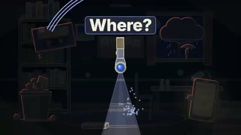

[← Back to gallery](../browse/education.en.md) · [简体中文](2113229122596163955.md)

# Focus Explained with Spotlights and Paper Diagrams

**[Chetaslua · @chetaslua](https://x.com/chetaslua)** · Education & explainers · 132s

> Discovery pool · Source verified; catalog details being completed.

**[▶ Open gallery to play](https://guanmo-ai.github.io/awesome-ai-motion/?lang=en#case-2113229122596163955)** · [Original post](https://x.com/chetaslua/status/2113229122596163955)

Click the cover to open the gallery and play.

Spotlights, a moving ball and paper diagrams turn an article about focus into an animated explanation with changing visual metaphors.

No public prompt has been verified. [View the original post](https://x.com/chetaslua/status/2113229122596163955)

Bookmarks 89 · Likes 159 · Views 8,808

## Source record

- Original post: [@chetaslua](https://x.com/chetaslua/status/2113229122596163955) · 2026-10-22T11:20:59+00:00
- Model attribution: Claude Opus 5.5 · [Creator’s statement](https://x.com/chetaslua/status/2113229122596163955)
- Prompt lookup: [Creator post](https://x.com/chetaslua/status/2113229122596163955) · 2026-10-23 05:30 UTC
- Cover source: [Original cover source](https://x.com/chetaslua/status/2113229122596163955) · 26.4s
- Metrics snapshot: [Original X post](https://x.com/chetaslua/status/2113229122596163955) · 2026-10-23 05:30 UTC
- Gallery video source: [Original post media record](https://x.com/chetaslua/status/2113229122596163955) · 2026-10-23 05:30 UTC · Post/media correspondence and media response checked; external reference, no re-upload

Model attribution is based on creator statements. Prompts have not been independently rerun; sound and visuals have not received a uniform quality rating. Videos reference original post media, not our uploads; redistribution permission has not been verified.
