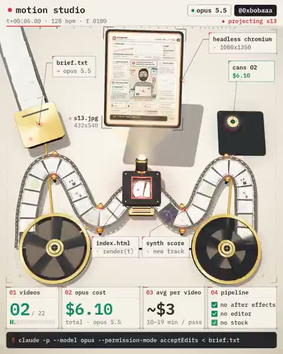

[← 返回图库](../browse/product.md) · [English](2113316452954517801.en.md)

# 用机械装置介绍代码动效制作

**[0xbobaa · @0xbobaaa](https://x.com/0xbobaaa)** · 产品宣传 · 30s

> 发现池 · 来源已核对，编目资料待完善。

**[▶ 打开画廊播放](https://guanmo-ai.github.io/awesome-ai-motion/#case-2113316452954517801)** · [作者原帖](https://x.com/0xbobaaa/status/2113316452954517801)

点击封面打开画廊播放。

胶片轨道、扬声器与屏幕构成一台图形化制作机器，计数卡片随画面推进展示创作概览。

未取得作者公开提示词。 [查看作者原帖](https://x.com/0xbobaaa/status/2113316452954517801)

收藏 198 · 点赞 193 · 浏览 10,767

## 来源记录

- 作品原帖: [@0xbobaaa](https://x.com/0xbobaaa/status/2113316452954517801) · 2026-10-22T17:08:00+00:00
- 模型归因: Claude Opus 5.5 · [作者说明](https://x.com/0xbobaaa/status/2113316452954517801)
- 提示词查阅记录: [作者原帖](https://x.com/0xbobaaa/status/2113316452954517801) · 2026-10-26 06:34 UTC
- 封面来源: [原帖封面来源](https://x.com/0xbobaaa/status/2113316452954517801) · 6s
- 互动快照: [X 原帖](https://x.com/0xbobaaa/status/2113316452954517801) · 2026-10-26 06:34 UTC
- 画廊原视频: [原帖媒体记录](https://x.com/0xbobaaa/status/2113316452954517801) · 2026-10-26 06:34 UTC · 已核对原帖媒体对应与媒体响应；外部引用，不重新上传

模型依据来自作者自述，未独立重跑提示词，也未对音画作统一质量评级。视频引用作者原帖媒体，未由本站重新上传，转载许可未确认。
