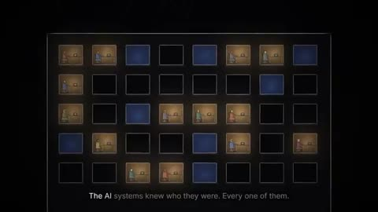

[← 返回图库](../browse/stories.md) · [English](2113392757548941441.en.md)

# 关于人工智能未来的图形寓言

**[ʞɔɐ𝘡 · @Skoorbkaz](https://x.com/Skoorbkaz)** · 叙事短片 · 700s

> 发现池 · 来源已核对，编目资料待完善。

**[▶ 打开画廊播放](https://guanmo-ai.github.io/awesome-ai-motion/#case-2113392757548941441)** · [作者原帖](https://x.com/Skoorbkaz/status/2113392757548941441)

点击封面打开画廊播放。

章节标题、房间网格和字幕在暗色画面中展开，用图形叙事构想人工智能主题的虚构未来。

未取得作者公开提示词。 [查看作者原帖](https://x.com/Skoorbkaz/status/2113392757548941441)

收藏 4,325 · 点赞 2,848 · 浏览 855,863

## 来源记录

- 作品原帖: [@Skoorbkaz](https://x.com/Skoorbkaz/status/2113392757548941441) · 2026-10-22T22:11:12+00:00
- 模型归因: Claude Opus 5.5 · [作者说明](https://x.com/Skoorbkaz/status/2113392757548941441)
- 提示词查阅记录: [作者原帖](https://x.com/Skoorbkaz/status/2113392757548941441) · 2026-10-26 06:34 UTC
- 封面来源: [原帖封面来源](https://x.com/Skoorbkaz/status/2113392757548941441) · 490.31s
- 互动快照: [X 原帖](https://x.com/Skoorbkaz/status/2113392757548941441) · 2026-10-26 06:34 UTC
- 画廊原视频: [原帖媒体记录](https://x.com/Skoorbkaz/status/2113392757548941441) · 2026-10-26 06:34 UTC · 已核对原帖媒体对应与媒体响应；外部引用，不重新上传

模型依据来自作者自述，未独立重跑提示词，也未对音画作统一质量评级。视频引用作者原帖媒体，未由本站重新上传，转载许可未确认。
