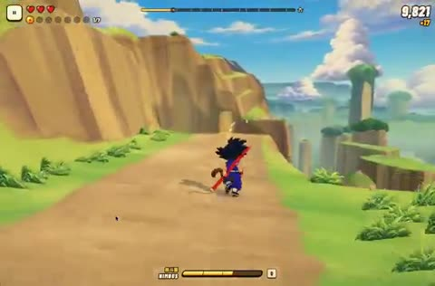

[← 返回图库](../browse/characters.md) · [English](2113427367477878971.en.md)

# 悟空穿越山谷的跑酷

**[Aniket J · @aniketjart](https://x.com/aniketjart)** · 角色动画 · 58s

> 发现池 · 来源已核对，编目资料待完善。

**[▶ 打开画廊播放](https://guanmo-ai.github.io/awesome-ai-motion/#case-2113427367477878971)** · [作者原帖](https://x.com/aniketjart/status/2113427367477878971)

点击封面打开画廊播放。

[龙珠同人跑酷作品入口](https://app.usecrayon.ai/play/3a9001a5-28fa-4ae0-ba5c-3b068d1912a4)

卡通角色沿山谷道路和水面前进，速度线、跳跃和地形变化组成同人跑酷展示。

## 源码与网页

- **公开网页**：[龙珠同人跑酷作品入口](https://app.usecrayon.ai/play/3a9001a5-28fa-4ae0-ba5c-3b068d1912a4)
  [链接出处](https://x.com/aniketjart/status/2113427367477878971) · 链接核对 2026-10-26 06:26 UTC

未取得作者公开提示词。 [查看作者原帖](https://x.com/aniketjart/status/2113427367477878971)

收藏 2,320 · 点赞 5,485 · 浏览 672,055

## 来源记录

- 作品原帖: [@aniketjart](https://x.com/aniketjart/status/2113427367477878971) · 2026-10-23T00:28:44+00:00
- 模型归因: Claude Opus 5.5 · [作者说明](https://x.com/aniketjart/status/2113427367477878971)
- 提示词查阅记录: [作者原帖](https://x.com/aniketjart/status/2113427367477878971) · 2026-10-26 06:34 UTC
- 封面来源: [原帖封面来源](https://x.com/aniketjart/status/2113427367477878971) · 11.67s
- 互动快照: [X 原帖](https://x.com/aniketjart/status/2113427367477878971) · 2026-10-26 06:34 UTC
- 画廊原视频: [原帖媒体记录](https://x.com/aniketjart/status/2113427367477878971) · 2026-10-26 06:34 UTC · 已核对原帖媒体对应与媒体响应；外部引用，不重新上传

模型依据来自作者自述，未独立重跑提示词，也未对音画作统一质量评级。视频引用作者原帖媒体，未由本站重新上传，转载许可未确认。
