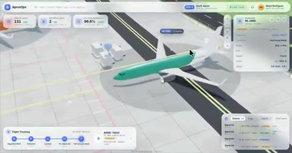

[← Back to gallery](../browse/interactive.en.md) · [简体中文](2113602878288052581.md)

# A Miniature World of Airport Operations

**[Viktor Oddy · @viktoroddy](https://x.com/viktoroddy)** · 3D & interactive · 26s

> Discovery pool · Source verified; catalog details being completed.

**[▶ Open gallery to play](https://guanmo-ai.github.io/awesome-ai-motion/?lang=en#case-2113602878288052581)** · [Original post](https://x.com/viktoroddy/status/2113602878288052581)

Click the cover to open the gallery and play.

Aircraft, jet bridges and service vehicles form an overhead airport scene with labels tracking flight activity.

No public prompt has been verified. [View the original post](https://x.com/viktoroddy/status/2113602878288052581)

Bookmarks 122 · Likes 241 · Views 11,801

## Source record

- Original post: [@viktoroddy](https://x.com/viktoroddy/status/2113602878288052581) · 2026-10-23T12:06:09+00:00
- Model attribution: Claude Opus 5.5 · [Creator’s statement](https://x.com/viktoroddy/status/2113602878288052581)
- Prompt lookup: [Creator post](https://x.com/viktoroddy/status/2113602878288052581) · 2026-10-24 12:20 UTC
- Cover source: [Original cover source](https://x.com/viktoroddy/status/2113602878288052581) · 5.21s
- Metrics snapshot: [Original X post](https://x.com/viktoroddy/status/2113602878288052581) · 2026-10-24 12:20 UTC
- Gallery video source: [Original post media record](https://x.com/viktoroddy/status/2113602878288052581) · 2026-10-24 12:20 UTC · Post/media correspondence and media response checked; external reference, no re-upload

Model attribution is based on creator statements. Prompts have not been independently rerun; sound and visuals have not received a uniform quality rating. Videos reference original post media, not our uploads; redistribution permission has not been verified.
