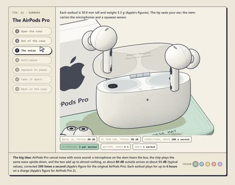

[← Back to gallery](../browse/education.en.md) · [简体中文](2113610053609464279.md)

# Earbud Teardown and Noise-Cancellation Waves

**[Kaero · @0x\_kaero](https://x.com/0x_kaero)** · Education & explainers · 38s

> Discovery pool · Source verified; catalog details being completed.

**[▶ Open gallery to play](https://guanmo-ai.github.io/awesome-ai-motion/?lang=en#case-2113610053609464279)** · [Original post](https://x.com/0x_kaero/status/2113610053609464279)

Click the cover to open the gallery and play.

Case opening, internal separation and inverted waves turn noise cancellation into an animated interactive lesson.

No public prompt has been verified. [View the original post](https://x.com/0x_kaero/status/2113610053609464279)

Bookmarks — · Likes — · Views —

## Source record

- Original post: [@0x\_kaero](https://x.com/0x_kaero/status/2113610053609464279) · 2026-10-23T12:34:40+00:00
- Model attribution: Claude Opus 5.5 · [Creator’s statement](https://x.com/0x_kaero/status/2113610053609464279)
- Prompt lookup: [Creator post](https://x.com/0x_kaero/status/2113610053609464279) · 2026-11-02 09:52 UTC
- Cover source: [Original cover source](https://x.com/0x_kaero/status/2113610053609464279) · 7.63s
- Metrics snapshot: [Original X post](https://x.com/0x_kaero/status/2113610053609464279) · 2026-11-02 09:15 UTC
- Gallery video source: [Original post media record](https://x.com/0x_kaero/status/2113610053609464279) · 2026-11-02 09:52 UTC · Post/media correspondence and media response checked; external reference, no re-upload

Model attribution is based on creator statements. Prompts have not been independently rerun; sound and visuals have not received a uniform quality rating. Videos reference original post media, not our uploads; redistribution permission has not been verified.
