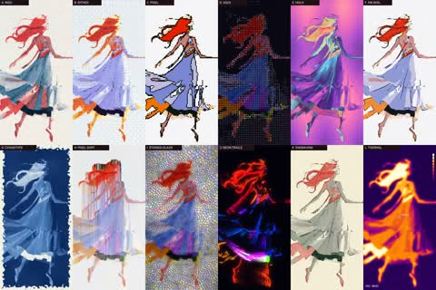

[← Back to gallery](../browse/motion.en.md) · [简体中文](2113615186556776531.md)

# Multi-Style Graphic Effects on a Cartoon Character

**[Kōda · @aimikoda](https://x.com/aimikoda)** · Motion design · 15s

> Discovery pool · Source verified; catalog details being completed.

**[▶ Open gallery to play](https://guanmo-ai.github.io/awesome-ai-motion/?lang=en#case-2113615186556776531)** · [Original post](https://x.com/aimikoda/status/2113615186556776531)

Click the cover to open the gallery and play.

One cartoon character changes through different colors, outlines and graphic effects.

No public prompt has been verified. [View the original post](https://x.com/aimikoda/status/2113615186556776531)

Bookmarks — · Likes — · Views —

## Source record

- Original post: [@aimikoda](https://x.com/aimikoda/status/2113615186556776531) · 2026-10-23T12:55:04+00:00
- Model attribution: Claude Opus 5.5 · [Creator’s statement](https://x.com/aimikoda/status/2113615186556776531)
- Prompt lookup: [Creator post](https://x.com/aimikoda/status/2113615186556776531) · 2026-11-02 15:38 UTC
- Cover source: [Original cover source](https://x.com/aimikoda/status/2113615186556776531) · 3.01s
- Metrics snapshot: [Original X post](https://x.com/aimikoda/status/2113615186556776531) · 2026-11-02 15:05 UTC
- Gallery video source: [Original post media record](https://x.com/aimikoda/status/2113615186556776531) · 2026-11-02 15:38 UTC · Post/media correspondence and media response checked; external reference, no re-upload

Model attribution is based on creator statements. Prompts have not been independently rerun; sound and visuals have not received a uniform quality rating. Videos reference original post media, not our uploads; redistribution permission has not been verified.
