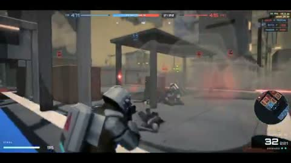

[← Back to gallery](../browse/characters.en.md) · [简体中文](2113674457210556568.md)

# A Procedural Science Fiction Arena

**[Frog King Simulator · @Belbizaz](https://x.com/Belbizaz)** · Pixel art & characters · 123s

> Discovery pool · Source verified; catalog details being completed.

**[▶ Open gallery to play](https://guanmo-ai.github.io/awesome-ai-motion/?lang=en#case-2113674457210556568)** · [Original post](https://x.com/Belbizaz/status/2113674457210556568)

Click the cover to open the gallery and play.

Armored characters move and fight through an industrial arena with ammunition, aiming and team overlays.

No public prompt has been verified. [View the original post](https://x.com/Belbizaz/status/2113674457210556568)

Bookmarks 266 · Likes 680 · Views 31,676

## Source record

- Original post: [@Belbizaz](https://x.com/Belbizaz/status/2113674457210556568) · 2026-10-23T16:50:35+00:00
- Model attribution: Claude Opus 5.5 · [Creator’s statement](https://x.com/Belbizaz/status/2113674457210556568)
- Prompt lookup: [Creator post](https://x.com/Belbizaz/status/2113674457210556568) · 2026-10-24 12:20 UTC
- Cover source: [Original cover source](https://x.com/Belbizaz/status/2113674457210556568) · 24.66s
- Metrics snapshot: [Original X post](https://x.com/Belbizaz/status/2113674457210556568) · 2026-10-24 12:20 UTC
- Gallery video source: [Original post media record](https://x.com/Belbizaz/status/2113674457210556568) · 2026-10-24 12:20 UTC · Post/media correspondence and media response checked; external reference, no re-upload

Model attribution is based on creator statements. Prompts have not been independently rerun; sound and visuals have not received a uniform quality rating. Videos reference original post media, not our uploads; redistribution permission has not been verified.
