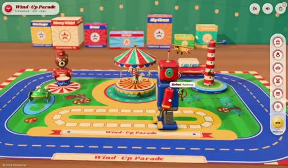

[← 返回图库](../browse/interactive.md) · [English](2113735969174360081.en.md)

# 发条玩具店的三维游乐场

**[Techartist · @techartist\_](https://x.com/techartist_)** · 交互演示 · 21s

> 发现池 · 来源已核对，编目资料待完善。

**[▶ 打开画廊播放](https://guanmo-ai.github.io/awesome-ai-motion/#case-2113735969174360081)** · [作者原帖](https://x.com/techartist_/status/2113735969174360081)

点击封面打开画廊播放。

机器人、旋转木马与玩具轨道组成桌面商店，镜头切换展示玩具动作和机械细节。

未取得作者公开提示词。 [查看作者原帖](https://x.com/techartist_/status/2113735969174360081)

收藏 154 · 点赞 222 · 浏览 9,397

## 来源记录

- 作品原帖: [@techartist\_](https://x.com/techartist_/status/2113735969174360081) · 2026-10-23T20:55:01+00:00
- 模型归因: Claude Opus 5.5 · [作者说明](https://x.com/techartist_/status/2113735969174360081)
- 提示词查阅记录: [作者原帖](https://x.com/techartist_/status/2113735969174360081) · 2026-10-26 06:34 UTC
- 封面来源: [原帖封面来源](https://x.com/techartist_/status/2113735969174360081) · 4.22s
- 互动快照: [X 原帖](https://x.com/techartist_/status/2113735969174360081) · 2026-10-26 06:34 UTC
- 画廊原视频: [原帖媒体记录](https://x.com/techartist_/status/2113735969174360081) · 2026-10-26 06:34 UTC · 已核对原帖媒体对应与媒体响应；外部引用，不重新上传

模型依据来自作者自述，未独立重跑提示词，也未对音画作统一质量评级。视频引用作者原帖媒体，未由本站重新上传，转载许可未确认。
