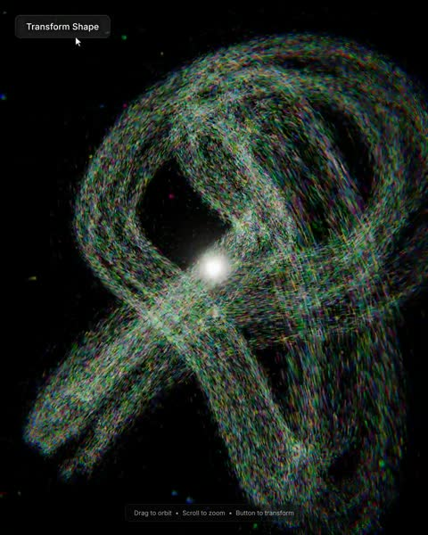

[← Back to gallery](../browse/motion.en.md) · [简体中文](2113976618972549440.md)

# A Particle Study with More Than Ninety Thousand Points

**[AiMind · @AIMind\_Ai](https://x.com/AIMind_Ai)** · Motion design · 35s

> Discovery pool · Source verified; catalog details being completed.

**[▶ Open gallery to play](https://guanmo-ai.github.io/awesome-ai-motion/?lang=en#case-2113976618972549440)** · [Original post](https://x.com/AIMind_Ai/status/2113976618972549440)

Click the cover to open the gallery and play.

Particles change among rings, spirals and flowing forms using Three.js and custom shaders.

No public prompt has been verified. [View the original post](https://x.com/AIMind_Ai/status/2113976618972549440)

Bookmarks — · Likes — · Views —

## Source record

- Original post: [@AIMind\_Ai](https://x.com/AIMind_Ai/status/2113976618972549440) · 2026-10-24T12:51:16+00:00
- Model attribution: Claude Opus 5.5 · [Creator’s statement](https://x.com/AIMind_Ai/status/2113976618972549440)
- Prompt lookup: [Creator post](https://x.com/AIMind_Ai/status/2113976618972549440) · 2026-11-02 09:52 UTC
- Cover source: [Original cover source](https://x.com/AIMind_Ai/status/2113976618972549440) · 7.01s
- Metrics snapshot: [Original X post](https://x.com/AIMind_Ai/status/2113976618972549440) · 2026-11-02 09:15 UTC
- Gallery video source: [Original post media record](https://x.com/AIMind_Ai/status/2113976618972549440) · 2026-11-02 09:52 UTC · Post/media correspondence and media response checked; external reference, no re-upload

Model attribution is based on creator statements. Prompts have not been independently rerun; sound and visuals have not received a uniform quality rating. Videos reference original post media, not our uploads; redistribution permission has not been verified.
