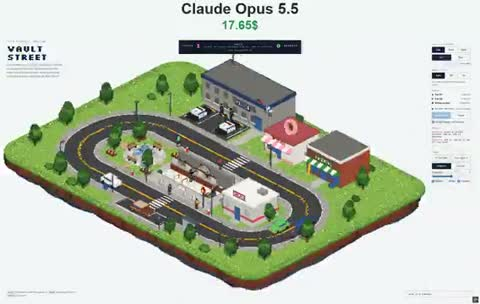

[← Back to gallery](../browse/characters.en.md) · [简体中文](2114054716959215724.md)

# A Bank Chase in a Pixel Town

**[Vib3Coded · @vib3coded](https://x.com/vib3coded)** · Pixel art & characters · 17s

> Discovery pool · Source verified; catalog details being completed.

**[▶ Open gallery to play](https://guanmo-ai.github.io/awesome-ai-motion/?lang=en#case-2114054716959215724)** · [Original post](https://x.com/vib3coded/status/2114054716959215724)

Click the cover to open the gallery and play.

Vehicles and characters move around a bank in a miniature district, with day, night, rain and traffic changing the chase scene.

No public prompt has been verified. [View the original post](https://x.com/vib3coded/status/2114054716959215724)

Bookmarks 60 · Likes 151 · Views 5,014

## Source record

- Original post: [@vib3coded](https://x.com/vib3coded/status/2114054716959215724) · 2026-10-24T18:01:36+00:00
- Model attribution: Claude Opus 5.5 · [Creator’s statement](https://x.com/vib3coded/status/2114054716959215724)
- Prompt lookup: [Creator post](https://x.com/vib3coded/status/2114054716959215724) · 2026-10-26 06:34 UTC
- Cover source: [Original cover source](https://x.com/vib3coded/status/2114054716959215724) · 3.4s
- Metrics snapshot: [Original X post](https://x.com/vib3coded/status/2114054716959215724) · 2026-10-26 06:34 UTC
- Gallery video source: [Original post media record](https://x.com/vib3coded/status/2114054716959215724) · 2026-10-26 06:34 UTC · Post/media correspondence and media response checked; external reference, no re-upload

Model attribution is based on creator statements. Prompts have not been independently rerun; sound and visuals have not received a uniform quality rating. Videos reference original post media, not our uploads; redistribution permission has not been verified.
